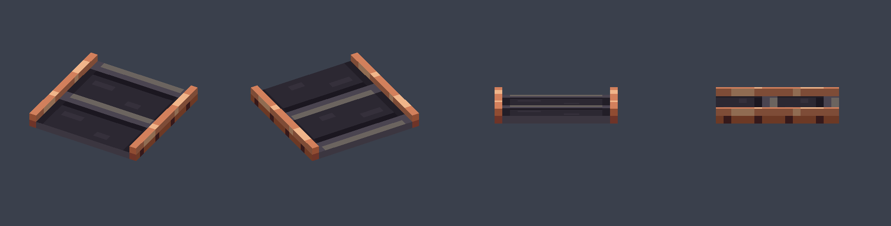
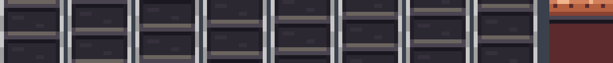
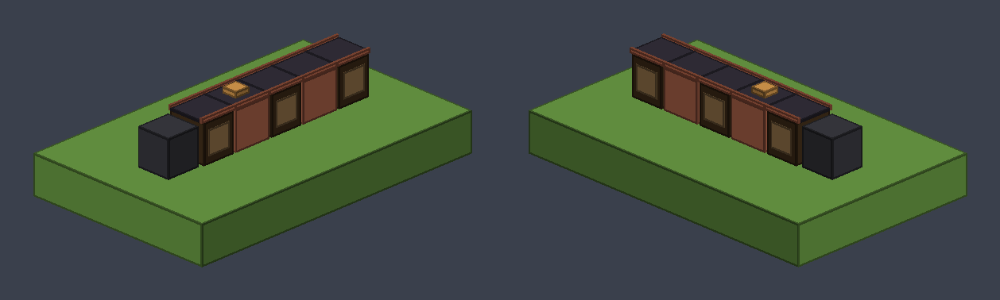
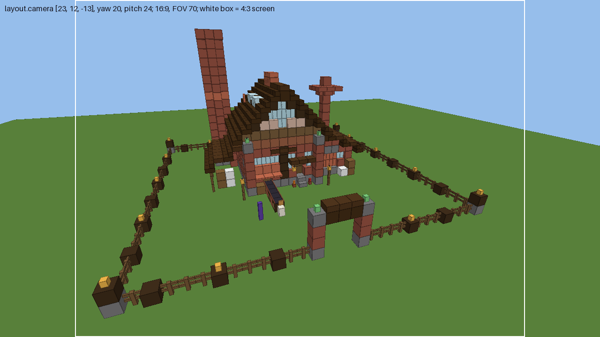

# Conveyor belt + build camera (feature `conveyor-belt`)

Status: placeholder (first pass, judged from previews; needs a look in game)

Three assets for the brief `docs/briefs/conveyor-belt.md`:
1. the moving belt surface, item model `cookieclicker:conveyor_belt` (resource pack);
2. the belt frame style `src/main/resources/houses/belt.yml` (vanilla blocks, plugin data);
3. the build-cinematic camera point `layout.camera` in `src/main/resources/houses/factory.yml`.

- **Target:** Paper 26.3 (`26.3.build.205-stable`), pack format 97 (`pack.mcmeta` unchanged).
- **Pipeline:** plain resource pack (`resourcepack/`) for the surface; plugin data files for the frame and camera.
- **Generators** (`mise run assets`, deterministic): `design/scripts/conveyor_belt.py` (model, textures, item definition), `design/scripts/belt_style.py` (`belt.yml`), `design/scripts/house_factory.py` (`factory.yml` incl. `layout.camera`, camera preview). Don't edit the outputs by hand.

## 1. Belt surface: `cookieclicker:conveyor_belt`

| What | Path |
|---|---|
| item model definition | `resourcepack/assets/cookieclicker/items/conveyor_belt.json` → `cookieclicker:item/conveyor_belt` |
| model | `resourcepack/assets/cookieclicker/models/item/conveyor_belt.json` |
| animated belt texture | `resourcepack/assets/cookieclicker/textures/item/conveyor_belt.png` (16 × 128 = 8 frames of 16 × 16) + `.png.mcmeta` |
| static frame texture | `resourcepack/assets/cookieclicker/textures/item/conveyor_belt_frame.png` (16 × 16) |

The code sets the `item_model` data component to **`cookieclicker:conveyor_belt`** on the item of an `ItemDisplay` (the vanilla item underneath is the coder's fallback choice, `belt.fallback-item`).




**Shape (3 cuboids, model units):**
| Element | From → to | Texture |
|---|---|---|
| rubber belt | `[1, 8, 0]` → `[15, 9, 16]` | top: animated belt; ends/bottom: dark rubber from the frame texture |
| west rail | `[0, 8, 0]` → `[1, 10, 16]` | waxed-copper rail with rivets |
| east rail | `[15, 8, 0]` → `[16, 10, 16]` | same |

- One cell long (16 units along Z), one cell wide, lies flat. Slats run across the belt (along X), so the belt runs along Z.
- **The model's bottom is at its origin** (model y 8 = the display's position with transform `NONE`). Spawn the display at **(cell x + 0.5, ground + `surface-height`, cell z + 0.5)**, `ItemDisplayTransform.NONE`, scale 1, no rotation: it rests on the frame. The rubber top is 1/16 above that; the rails 2/16.
- **Belt cookies** ride at **ground + surface-height + 0.0625** (bottom of the cookie). With `surface-height` 1 that is y 1.0625; the pedestal block display is 0.95 high, so cookies step down 0.11 onto it at the end.
- **Motion:** on the up face the texture's top row lies on the north (-Z) edge; each frame rolls the slats one texel towards it, so the belt moves **north, towards the pedestal**, at 1 texel / 2 ticks = **0.625 blocks/s** (fixed: a texture animation can't follow CPS; the cookies' speed shows CPS). Loop: 8 frames, `frametime` 2, `interpolate` false (blending would smear the slats).
- **Check in game (not verified):** whether item displays turn the model 180° about Y. The model is symmetric, so if the slats run into the hatch instead of towards the pedestal, give the surface displays yaw 180. Nothing else changes.
- `display` transforms are set for gui/ground/fixed/hand/head so the item also looks fine in an inventory (e.g. for an admin give); the belt itself uses `NONE`.

**Palette:**
| Role | Hex |
|---|---|
| rubber shadow (slat contact shadow) | `#1B1720` |
| rubber edge | `#221E27` |
| rubber base | `#2C2832` |
| scuffs | `#35303B` |
| slat | `#4A4450` |
| slat highlight (north edge, lit) | `#6B645F` |
| copper highlight / light / base / shadow / dark (rivets) | `#F0B58A` `#D2805C` `#B5603F` `#8A4232` `#5A2A2C` |

Copper matches the factory's waxed copper awning and lintel; the rubber ramp is hue-shifted (warm highlight, purple shadow).

## 2. Belt frame: `src/main/resources/houses/belt.yml`



```yaml
direction: north                       # belt runs -Z, hatch -> pedestal; block states are written for this
surface-height: 1                      # frame column height (blocks); the surface display rests on top
item-model: "cookieclicker:conveyor_belt"
columns:                               # named columns, block data bottom -> top, length = surface-height
  roller: ["minecraft:spruce_log[axis=x]"]
  housing: ["minecraft:waxed_copper_grate[waterlogged=false]"]
first: roller                          # cell 0 = layout.belt.from (belt_out, at the hatch)
last: roller                           # cell n-1 = layout.belt.to (next to the pedestal)
middle: [housing, roller]              # cells 1 .. n-2: middle[(i - 1) % len(middle)]
```
**Parsing rules for the coder:**
- Walk the belt cells from `layout.belt.from` to `layout.belt.to` (inclusive, `from` = index 0). Cell `i` gets column `first` (i = 0), `last` (i = n − 1), else `middle[(i − 1) % len(middle)]`. For the factory's 5 cells: roller, housing, roller, housing, roller.
- Place column block `k` at y = ground y0 + k (y0 = the first air layer above the ground, same as every layout cell), physics off like the houses.
- Only the belt cells themselves change, from y0 to y0 + surface-height − 1. Backup and `setup undo` cover exactly those cells. Nothing beside the belt, so the barrel next to the hatch and the shop are untouched.
- `direction` is always `north` (straight belts only, brief "Out of scope"); refuse other values. Logs lie across the belt (`axis=x`) so their ring ends show on the sides like rollers.
- **Height budget at the hatch:** frame top 1.0, rubber 1.0625, rails 1.125, a cookie at the default scale up to about 1.4. The copper awning above `belt_out` starts at 1.8125 (top-half trapdoor at y1), so it all fits. `belt_style.py` asserts this; `house_factory.py` asserts that the cell above every belt cell is air or a closed top-half trapdoor.
- **Without the pack:** the frame is plain vanilla and still reads as a belt bed; the surface display falls back to the coder's `belt.fallback-item` (e.g. black carpet).

## 3. Build camera: `layout.camera` in `factory.yml`

```yaml
layout:
  ...
  camera: {at: [23, 12, -13], yaw: 20, pitch: 24}
```
- **Meaning:** like `viewpoint`, `at` is a feet cell in plot cells (from the plot's min corner; y 0 = first air layer above the ground). The player/camera stands at the **bottom centre** of that cell, so the eye is at **(23.5, y0 + 12 + 1.62, −12.5)**. It lies **outside the plot** (13 blocks north of the front fence, 8 east of the plot centre) and 12 blocks up. `yaw` 20 / `pitch` 24 are Minecraft angles (yaw 0 = south, positive = turning west; pitch positive = looking down): a 3/4 view looking south-south-west and down at the facade, belt and pedestal, with the whole fence ring in frame.
- All ints. Optional: layouts without `camera` (the cottage `default.yml`) keep today's cinematic.
- **If the coder uses an entity for `setSpectatorTarget`**, put that entity's eye at the eye point above (an entity's location is its feet, so place it at eye − its eye height), facing yaw 20 / pitch 24.



**How it was checked:** `house_factory.py` projects the fence ring corners (with lanterns), the gate arch, all 8 corners of the design box (incl. the tall stack top) and the pedestal with the game's default **FOV 70** (vertical) on a **4:3** screen, the narrowest common one, and asserts they all stay within 95% of the frame (x −0.94..0.84, y −0.89..0.94). The preview above is rendered with `voxel_render.render_perspective` at 16:9; the white box is the 4:3 crop. A wider FOV only adds margin; a lower FOV (e.g. 60, or a zoom mod) crops the fence corners first.

The old `viewpoint` [15, 0, 2] stays: it is where the player stands **after** the build (by the gate, looking at the factory).

## Placeholders / needs a human
- **Placeholder:** both belt textures (first pass, my own pixel art). The belt frame and the camera point are first passes too.
- **Check in game:** the belt direction (slats must move towards the pedestal, see the yaw note above), the texture speed next to the cookies at low/high CPS, the camera framing at the user's FOV and screen, and whether the camera's height and distance feel right while the factory drops in.
- **Sound/effects:** `belt_loop` (sound-designer) and `belt_arrive` (vfx-designer) are in the brief; nothing from me needed.
