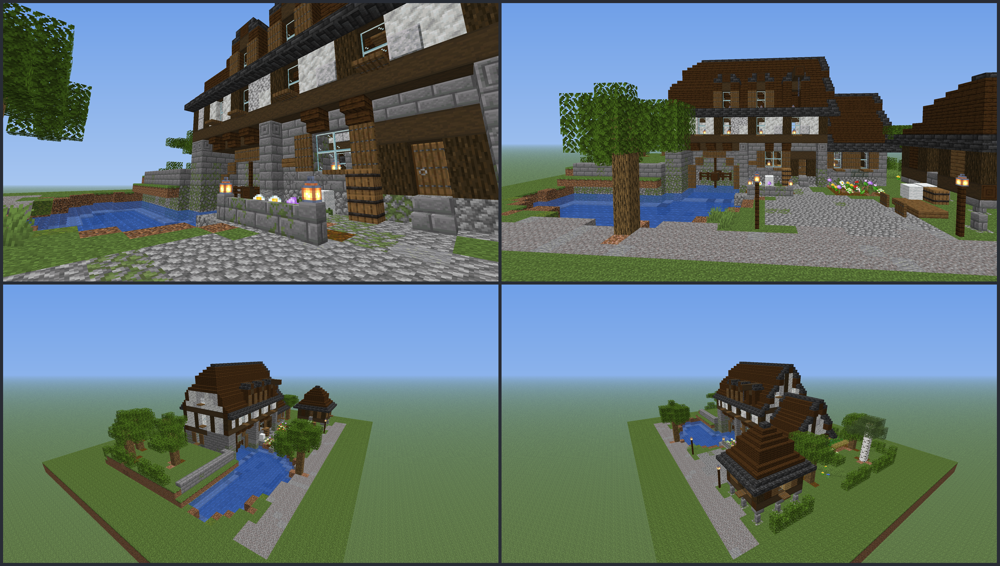

# Countryside: place files, `countryside.yml` and the Mill

Status: placeholder (Mill gate: run 1 of `countryside-builds`; textured previews reviewed once, needs the user's look and a Chunky pass). Target Paper 26.3 (`26.3.build.205-stable`), pack format 97.1. Research: `docs/research/farm-buildings.md`. Build rules: `design/style-guide.md` (R1-R21, D1-D7), `design/build-lint.md` (R rules and the farm rules L-F1..L-F11). Vanilla blocks only, except the waterwheel item model.

## 1. File format (agreed with the coder, implemented in the plugin)

### Place files `src/main/resources/houses/<place>.yml`
The existing house format (`size`, `origin`, `ground-depth`, `palette`, `layers`, `signs`; see `design/house-default.md`) with these differences and additions:
- `ground-depth` is allowed up to **4** (design y -4..-1 are the first four layers). Surface block (grass, cobble ...) is design y **-1**; design y 0 is the first air layer above the ground.
- Generated in the **final orientation**: nothing is rotated at paste. The **road side faces north (-Z)**.
- `.` or a space = keep (the terrain below stays); every other char overrides the countryside (places paste after it).
- **Points**: y counts from the first layer above `ground-depth` (design y); every point lies inside `size`.

```yaml
points:
  viewpoint: {at: [16, 0, 5], yaw: -20, pitch: 12}   # required; `at` = the player's FEET cell; yaw/pitch default 0
  yard: {from: [11, 3], to: [21, 9]}                 # required; [x, z], inclusive, any order, at yard ground level
  hologram: [16, 1, 7]                               # required
  panel: {at: [20, 0, 7], yaw: 180}                  # required; yaw = the way the panel faces (180 = north, towards the viewer)
  ripe: [12, 0, 7]                                   # required
  smoke: [[x, y, z]]                                 # optional, 0 or 1 entries (the single chimney)
  wheel: {at: [28, 0, 16], axis: z}                  # optional (Mill): the axle centre CELL; axis = axle direction (x or z)
  recipe_book: [x, y, z]                             # optional (market, later run)
  notice_board: {at: [x, y, z], yaw: 180}            # optional (market, later run)
```
Rules the generators assert (and `lib/place_lib.check_points` re-checks): all required points present; clickable points (hologram, panel, ripe) within **5 blocks** of the viewpoint (cell centres); no water, leaves or flowers in their 1 x 2 hitbox cells; viewpoint feet and head free over a solid block; a calm backdrop and lanterns around the panel; lit at night (lint L-F3).

### `countryside.yml` (run 2)
House format for terrain, road, stream and scenery (about 150 x H x 120, `ground-depth` <= 4) plus
```yaml
places:                          # names [a-z0-9_]; each loads houses/<name>.yml; NO yaw (non-zero is rejected)
  market:  {at: [x, y, z]}
  mill:    {at: [x, y, z]}
  cow_barn: {at: ...}   sugar_works: {at: ...}   cocoa_grove: {at: ...}   chicken_farm: {at: ...}
```
- The file's `origin` cell (default `[0,0,0]`) lands on the **farm region's min corner**, so the region's min y = ground level.
- `at` = where the place file's min corner (its cell [0,0,0] above `ground-depth`) lands. A place must stay inside the countryside's x/z box and top, and may reach at most 4 layers below the region's min y.
- Places paste in file order after the countryside; the countryside leaves each place box as keep.
- The Mill's road (3-wide gravel, `z 0..2`, see below) must meet the countryside's road at the Mill's north edge, at the same height (ground y -1).

## 2. Kits (`design/scripts/lib/farm_kits.py`, tests `lib/tests/test_farm_kits.py`)
Every kit is a named, deterministic function (variation from the Build's seeded rng or explicit seeds). The tests run in `mise run assets` (`design/scripts/farm_kit_tests.py`) and with `python -m unittest discover -s design/scripts/lib/tests`.

| Status | Kits |
|---|---|
| **done** (used by the Mill, tested) | `hipped_roof` (one solver for gable / half-hip / hip / pyramid: level = min over sloping sides of distance + k, steep 1.5-per-step pitch table with filled risers, stairs face the ridge, eave and rake rows, ridge + cap), `half_hip_roof`, `gable_roof_s`, `pyramid_roof`, `pent_skirt`, `dormer` (3-wide gabled dormer that runs back until the main roof reaches it; `hatch=True, beam=True` = **hoist gablet** with chain and barrel), `coped_gable`, `staddle_stones`, `retaining_wall`, `stone_bridge` (fenced, lanterns, open span), `wheel_slot` (piers, floor, back wall, lintel beam, axle bearing, static fallback wheel), `mill_race` (stone-lined still water + coping), `pond` (bed, shelf, water, lily pads), `height_field_ground`, `terrace`, `cut_and_fill` |
| **simple** (tested, small, not yet used) | `vent_slits`, `board_and_batten`, `nest_box_row`, `hurdle_fence`, `stone_pillar_fence`, `buttress`, `awning`, `drying_rack`, `orchard_grid`, `furrow_field` |
| **done in run 2a** (Cow Barn, tested) | `catslide_roof` (stairs + bottom slabs, half a block per row), `fill_under`, `corbie_gable` (stepped gable wall + slab caps), `barn_door_double` (braced 5 x 4 leaves, centre stile, jambs, lintel, big-door registration), `hipped_roof(clip=main)` (cross-gable buried in the main roof); `coped_gable` now also registers its caps as roof cells |
| **stub** (raise `NotImplementedError`, test asserts it; run 2b) | `round_building` (8-gon), `cone_roof`, `hay_roll_thatch`, `eyebrow_dormer` |

Other new lib files: `place_gen.py` (run 2a: road, lawn, meadow, hedges, drystone walls, trough, hay rick, and `finish()` = block ids, points, lints, YAML, previews; `lint_place(size_range=)` for the market), `place_lib.py` (points contract + place YAML writer), `place_views.py` (previews), `farm_lint.py` (L-F rules), `block_ids.py` (sources-jar validator).

## 3. Lint (`lib/farm_lint.py`, rules in `design/build-lint.md` "Farm places")
L-F1 volumes, L-F2 roof forms and big planes, L-F3 yard, L-F4 clearance (wheel disc, enclosed water, cocoa), L-F5 big doors, L-F6 ground (5 x 5 patches, straight shores), L-F7 chimney/vent, L-F8 contrast and stair share, L-F9 roof heights (and optional roof share), L-F10 water share of the frontage, L-F11 gable finish, plus block count (hero 1,500-3,500, small 600-1,200 above ground). A place that fails is **not written** (previews are). Tests: `LintTests` in `lib/tests/test_farm_kits.py`.

## 4. Block ids
`mise run assets` runs `design/scripts/farm_block_ids.py` against `org/bukkit/Material.java` in the paper-api 26.3.build.205 sources jar (and every generator asserts its palette against it). All `(v?)` ids of the research note exist in 26.3: `resin_brick_stairs/slab`, `resin_bricks`, `pale_oak_*`, `bee_nest`, `beehive`, `weathered_cut_copper_stairs`, `deepslate_tile_stairs`, `blackstone_stairs`, `cobbled_deepslate_stairs`, `tuff_bricks`, `mud_brick_stairs`. 58 ids checked, none missing. They are kept; the Mill itself uses only the ones listed in its palette.

## 5. Mill (`houses/mill.yml`, generator `design/scripts/house_mill.py`, layout `mill_layout.py`)
- **Purpose:** flour place of the Ingredient Farm. A stone watermill standing on a retaining wall straight out of its pond; the waterwheel turns in a stone slot between two piers under the jettied upper floor.
- **File:** `size: [46, 24, 36]` = design box 46 x 20 x 36 above the ground + 4 ground layers (volume 39,744 < 40,000). **9,482 blocks written (3,045 above ground without water = building + scene, in the 1,500-3,500 range)**, 132 palette entries. Generated: do not edit the YAML by hand.
- **Orientation:** final. Road and yard on the north edge, the pond east of the yard and in front of the wheel, the back garden south.
- **Previews (textured, real 26.3 textures; the wheel is an item display and is **not** in the renders, only its block fallback):** `design/scripts/previews/place_mill_sheet.png`, `_eye` (player at the viewpoint), `_front`, `_ne`, `_nw`, `_back`, `_above`, `_slot` (wheel slot), `_water` (pond view), `_yard`.



### Layout (design cells)
| Part | Cells |
|---|---|
| Road | gravel, z 0..2 the whole width, south edge wobbles |
| **Front yard** | x 11..21, z 3..9 (11 x 7) cobble / mossy / andesite / gravel, wobbling edge, clear of blocks; lamp posts at (10,3) and (22,3) |
| Porch strip | z 10..14: gravel path to the door at x 16..19, flower beds, crates and sacks at the door, low backdrop wall + lanterns at x 19..23, z 10 |
| Hall | x 15..33; ground storey z 15..24 (plinth y0, stone y1..3, string course y4); upper floor z 14..24 (**jetty on the north**: bressumer y5, plaster upper y6..7, plate y8); half-hip roof east end, gable west end; ridge y15 + cap y16 |
| Wheel slot | interior x 25..31 (7 wide), z 15..17, piers x 23..24 and 32..33, back wall z 18, floor y -4, beam lintel y4, pilasters at z 14 (x 15, 24, 32, 33) carry the jetty; pit water y -3..-2 |
| Pond A | one broad organic pond (noisy ellipse + the strip against the hall wall), about x 23..44, z 3..14 (z <= 12 east of x 34), water y -3..-2, mud/clay/moss shore, lily pads; the tail race leaves through the east edge at z 8..9 (water exits `x 45`) |
| Wing (store) | x 8..14, z 15..23, in line with the hall, abuts its west gable; ridge y10 |
| Sack shed | lean-to x 25..31, z 25..27 on the south wall, barrels and sacks |
| Terrace + head race | terrace surface y 1 for x 35..45, z 13..30 behind a stone retaining wall (z 13) to the pond; a stone-lined channel x 33..44, z 16..17 (water y 0) runs from the east wall through the east pier into the slot (gate: trapdoors + bars at x 32, sluice gate with lever at x 34); **fenced stone bridge** x 37..39, z 14..19 (deck y 2); orchard on the terrace |
| Granary | staddle stones, 7 x 7 at x 2..8, z 4..10, floor y2, walls y3..4, pyramid roof ridge y9 + cap y10, door + stone steps on the east face (towards the yard), shuttered lit windows |
| Scenery | meadow clusters, trees (one with vines over the pond), hedge segments at the south and west edge, back garden (farmland, water channel) at x 9..15 z 28..32, woodpile, bench, sack cart west of the yard |

### Look (factory craft, scaled)
Stone ground storey in a stone-brick ramp on a cobble/mossy plinth, jettied plastered upper floor in a dark-oak frame (posts every 4, braces, flower-boxed shuttered lit windows), brackets under the bressumer, **steep (about 56 degrees) dark-oak shingle roof** with dark deepslate patches only (no light blocks), **deepslate-tile eave and rake** and a dark-oak ridge with a slab cap, **half-hip** east end, **two dark-oak dormers** and the **hoist gablet** (open hatch, beam, chain and barrel) on the north slope plus one dormer on the south slope, roofs at 8 heights (3, 4, 5, 8, 10, 11, 12, 16). One chimney budget unused (**no chimney**, `smoke` omitted).

### Points (design cells)
| Point | Value |
|---|---|
| `viewpoint` | `at [16, 0, 5]`, yaw -20, pitch 3 (the north edge of the yard, looking south-east at the front, the wheel and the pond) |
| `yard` | `from [11, 3]`, `to [21, 9]` |
| `hologram` | `[16, 1, 7]` (yard centre) |
| `panel` | `at [20, 0, 7]`, yaw 180 |
| `ripe` | `[12, 0, 7]` (beside the sack cart at x 9..11) |
| `wheel` | `at [28, 0, 16]`, axis `z` |
| `smoke` | none |
| signs | `[23, 2, 14]`: "The Mill" on a spruce wall sign |

Distances from the viewpoint centre (16.5, 0.5, 5.5): hologram 2.1, ripe 4.5, panel 4.7 (all <= 5).

### Waterwheel (item model `cookieclicker:waterwheel`, spec `design/waterwheel.md`)
Breastshot, **7 blocks across, 2 wide**, **16 paddles** (not 12: single-axis element rotation only allows 22.5-degree steps), 58 cuboids, texture 32 x 32 placeholder. Placed as an item display with transform `NONE` at the centre of the `wheel` cell with scale **7/3 (2.333)**; the display rotates about the model's local x axis. The block fallback inside the slot (fences and open trapdoors, above water only) stays under it.

### What is placeholder / needs a human
- The whole place: placeholder until the user's look at the Chunky shots (`Status: final` only with approval).
- Waterwheel texture and the rotation sign (checked in the renderer only; verify the paddles look radial in game).
- Open: the head race does not drive a visible water jet onto the wheel (physics off); pond lily pads and mossy shore are random but seeded.

## 6. Cow Barn (`houses/cow_barn.yml`, generator `design/scripts/house_cow_barn.py`)
- **Purpose:** milk place. A long medieval threshing barn whose clay-tile roof is the dominant mass (eaves y 5, ridge y 11 + stone-brick cap y 12; about 58% of the facade height).
- **File:** `size: [48, 22, 36]` (volume 38,016); 9,049 blocks written, **2,137 above ground** (1,500-3,500), 132 palette entries. Road on the north edge (3-wide gravel z 0..2).
- **Parts (design cells):** barn body x 8..32, front wall z 14, back wall z 26: plinth y0 (cobble ramp), board-and-batten walls (spruce / oak / dark oak planks, stripped-spruce battens) on dark-oak log posts every 4 (proud under the eaves), plate y5. Roof: half-hipped both ends (k 3), 56 degree brick / mud-brick / resin-brick stairs, dark-oak eave and rake, stone-brick ridge with slab cap; **catslide outshut** z 23..27 on the back (stairs + slabs, 26 degrees, low plate y3) with stall half-doors; brick gables with iron-bar vent slits. **Cart porch** x 17..23, z 11..14: stone piers, log lintel, **one corbie (stepped) gable** (tops 7, 9, 10, 11, slab caps), spruce fence gates and a post across the opening, **braced double doors** (5 wide, 4 high, centre stile, Z-braces) behind, hanging lanterns, cross-gable roof clipped into the main roof. **Three dormers** on the front (x 12, 27, 31); the one at x 27 is the **hoist** (open hatch, beam, chain, hay bale). **Dairy lean-to** x 33..39, z 17..21 on the east gable (calcite plaster ramp, dark-oak frame, door, shuttered lit windows, barrels, louvre at (34, 8, 19..20), no chimney). Vines on the front wall.
- **Surroundings:** yard x 14..24, z 3..9 (cobble ramp); gravel path to the gate; flower beds; backdrop wall z 10 (x 22..25) with lanterns; lamp posts at (13,3), (25,3); **paddock** x 1..13, z 4..13 west of the yard with a 2-high drystone wall, trough, hay feeder, trampled mud, gate at (13, 0, 7); hay rick (x 36..41, z 5..7), haycart, woodpile, bench, pasture trees, hedges and a field wall south.
- **Points:** `viewpoint` at [18,0,5] yaw -12 pitch 3; `yard` [14,3]..[24,9]; `hologram` [19,1,7] (2.4 from the viewpoint); `panel` at [22,0,7] yaw 180 (4.5); `ripe` [14,0,7] beside the paddock gate (4.5); no `smoke` (no chimney). Sign "Cow Barn" at [17,2,10].
- **Previews:** `design/scripts/previews/place_cow_barn_*.png` (sheet, eye, front, ne, nw, back, porch, dairy, paddock, above). 2 preview rounds.
- **Placeholder / open:** whole place until the user's look; the resin-brick patches are rare (4%) but bright; the back (south) side and the paddock interior are plain; cows/hay are display entities added by code.

## 7. Chicken Farm (`houses/chicken_farm.yml`, generator `design/scripts/house_chicken_farm.py`)
- **Purpose:** egg place. Stone coop with a steep clay-tile roof, **coped gable parapets** (slab caps) at both ends, a stepped buttress at the west gable, nest boxes on the west wall, dark shuttered windows, pop hole with ramp on the run side; **square dovecote** 5 x 5 (x 25..29, z 13..17) with a rat ledge (stone-brick slabs at y3), open dark-oak trapdoor nesting holes, pyramid roof and a **louvre cupola** (fence, 4 open trapdoors, lantern; registered as vents, not a chimney).
- **File:** `size: [40, 20, 34]` (27,200); 6,634 blocks, **1,194 above ground** (600-1,200, close to the top), 106 palette entries.
- **Parts:** coop walls x 10..20, z 13..19 (stone / andesite / stone-brick ramp on a cobble plinth), ridge y 8 + cap; pilasters for depth; run x 9..23, z 22..30 fenced with 2-high cobblestone-wall pillars every 4 and spruce fence between, hurdle divider, trough, hay, scarecrow, gates at (9,26) and (12,22); terraced backdrop x 32..39 (two levels, retaining walls with coping), haystack, two orchard trees; hedges south.
- **Points:** `viewpoint` [15,0,5] yaw -10 pitch 3; `yard` [12,3]..[22,9]; `hologram` [16,1,7] (2.4); `panel` at [19,0,7] yaw 180 (4.5, backdrop wall at z 10 with lanterns); `ripe` [12,0,8] (4.2, hay nest at x 10); no `smoke`. Sign "Chicken Farm" at [14,2,11].
- **Previews:** `design/scripts/previews/place_chicken_farm_*.png`. **Open:** the run interior is empty on purpose (hens are display entities); the place is at the top of the size range, so extras must replace something.

## 8. Market village (`houses/market.yml`, generator `design/scripts/house_market.py`)
- **Purpose:** hub of the countryside (Recipe Book, notice board, signpost). Roofs dark-oak shingle like the Mill.
- **File:** `size: [44, 20, 34]` (29,920); 6,831 blocks, **847 above ground** (600-2,000 allowed for the hub; lint `size_range`), 89 palette entries. The yard is outside the village wall; the square is inside.
- **Parts:** 2-high drystone village wall along z 11 (x 2..41) with the **roofed timber lychgate** x 18..22, z 11..13 (gable roof, planked gable ends, hanging lantern); **notice board** at x 11..14, z 10 (posts, planks, open trapdoor notices); cobbled **square** (noisy ellipse x 3..40, z 12..30); old stone **well** at (31, 17) (S.well); stepped **market cross** at (22, 20); **Recipe Book shelter** x 8..12, z 17..21: dais, corner posts, spruce balustrade with three openings, bookshelves on the west side, pyramid shingle roof with a lantern finial; **three striped stalls** (red/white at x 27..30, z 5..8 = the produce stall beside the yard and ripe spot; blue/white x 28..31, z 24..27; yellow/white x 34..37, z 20..23); **signpost** at (36, 0..3, 14) with two wall signs (Mill / Cow Barn / Sugar Works / Cocoa Grove / Chicken Farm); lamp posts, benches, crates, two trees, hedges.
- **Points:** `viewpoint` [21,0,5] yaw 0 pitch 3 (looks at the lychgate); `yard` [15,3]..[25,9]; `hologram` [20,1,7] (2.4); `panel` at [23,0,7] yaw 180 (2.8, wall and lanterns behind); `ripe` [25,0,7] (4.5, in front of the produce stall); **`recipe_book` [10,1,19]** (the lectern is placed by code on the dais cell [10,0,19]; no lectern in the file because the house format has no lectern block); **`notice_board` at [12,0,9] yaw 180**; no `smoke`.
- **Previews:** `design/scripts/previews/place_market_*.png`. **Open:** the market is sparse (no cottage this run); lint skips the depth rule (open timber structures); the sign texts are placeholders; the produce stall's goods are barrels and pumpkins only.

## 9. Run 2a status
Kits done: see section 2. Stubs left for run 2b: `round_building`, `cone_roof`, `hay_roll_thatch`, `eyebrow_dormer`. Sugar Works, Cocoa Grove and `countryside.yml` are run 2b. Checks: `mise run assets`, `validate-assets`, `tools-test` green.
