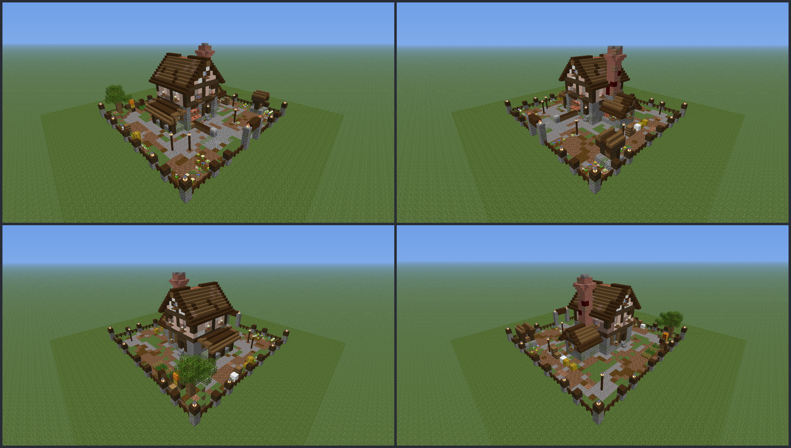

# Plot decoration: `houses/decor.yml`

Status: placeholder (rebuilt 2026-10-24 for `build-quality`: scenes over the whole plot; textured plan + Chunky shots reviewed, needs a look in game)

- **Purpose:** the ground treatment and props around the factory so the fenced plot looks lived-in everywhere, also around the house (feature `build-quality`; replaces the lone-flower layout of `plot-polish`). `/bakery plot setup` places them after house, fence and belt; backup/undo covers them like the rest.
- **Pipeline:** plugin data file, vanilla blocks only. **Generated** by `design/scripts/decor_style.py` (`mise run assets`); don't edit the YAML by hand. Scene kits: `design/scripts/lib/scenes.py`; lint: `design/build-lint.md` (D1/D2/R15).
- **Previews (textured, whole plot with factory, fence and belt):** `design/scripts/previews/decor_sheet.png` (4 corner views), `decor_eye.png`, `decor_ne/nw/se/sw.png`. Chunky shots: `~/bakery-review/shots/factory_{eye,34,door}.png`.
- **Target:** Paper 26.3. Block data is checked by `house_lib.check_block_data` and the client-jar cross-check. 640 blocks in 18 scenes.



## Format (the coder parses exactly this)
```yaml
blocks:
  - {at: [15, -1, 4], block: "minecraft:gravel"}
  - {at: [24, 3, 4], block: "minecraft:lantern[hanging=false,waterlogged=false]"}
```
- `at: [x, y, z]` ints in **plot cells from the plot's min corner** (same frame as `layout:` in factory.yml): x west to east, z north to south, **y 0 = first air layer above the ground; y -1 = the ground's top block, y -2 = the block under it** (new). Both ground levels replace the plot's block there (paths, gravel, beds, farmland, water). y max is 8.
- `block`: full block data, explicit states for every stateful block. YAML `#` comment lines name the scenes.
- Placement: physics off (so enclosed water stays still, nothing pops). One block per cell. **Leaves are forced `persistent=true`** by the plugin (the file also writes it). Everything (ground levels too) is backed up and restored by `/bakery plot setup` undo.
- Plants never rely on the ground: each stands on soil the decor places at y -1 (podzol, coarse dirt, rooted dirt, grass block, farmland) or on a mound block at y 0.
- All cells are inside the interior, x 1..29, z 1..28.

## Keep-outs (parser check)
| | Cells | Applies to |
|---|---|---|
| fence ring | `x == 0`, `x == 30`, `z == 0`, `z == 29` | every y |
| house design box | `x 6..24`, `z 10..23` (design box at `house-at [6, 0, 10]`, its ground layer is the house design's) | **ground cells (y < 0)** |
| belt cells | `x 18`, `z 7..11` | ground cells (y < 0) |
| factory margin | `x 5..25`, `z 9..24` | y >= 0 |
| front zone | `x 12..23`, `z 1..8` (gate walk, click area, pedestal, panels, belt, viewpoint, holograms) | y >= 0 |
| building slots | the footprint squares of `houses/building-slots.yml` + 0.35 (`building_slots.zone_cells`) | y >= 0 |

So **ground decor (y -1 / -2) may go anywhere inside the ring except the house design box and the belt cells** (the front zone, the walk and the slot yards are allowed), while **y >= 0 decor keeps every old keep-out**. The generator asserts both (`Decor.put`).

## Scenes (what they are)
| Scene | Where (x, z) | Content |
|---|---|---|
| `main_walk` | x 13..17, z 1..9 | gravel lane from the gate (wanders +-1) to the plaza and on to the house path |
| `pedestal_plaza` | x 14..22, z 3..8 | cobblestone / mossy / andesite plaza under the pedestal, panels and belt end |
| `baker_yard` | x 2..12, z 1..7 | coarse dirt / podzol yard under the villager slots, a lane to the plaza |
| `portal_yard` | x 24..29, z 2..6 | the same under the portal slot, a lane from the plaza |
| `ring_lane` | z 9 (x 4..26), x 4..5, z 25, x 26 | a 2-3 wide gravel lane ringing the factory; the shipping, alchemy, oven and extra-belt slots face it |
| `shipping_yard`, `oven_yard`, `belt_yard` | x 1..4 / x 25..29 / x 7..17 | packed-earth yards under the slots |
| `gate_bed_west`, `gate_bed_east` | x 10..11, z 1..5 / x 24..29, z 1..4 | podzol flower beds against the fence beside the gate walk |
| `well_yard` | x 1..3, z 1..9 | a **well** (3 x 3 mossy stone ring, enclosed water at y -1/-2, posts, stair roof, chain, bucket) with flower beds |
| `west_store` | x 4, z 11..19 | barrels, flour sacks (wool + carpet), hay bales, a lamp post on its own apron |
| `east_beds`, `oven_store` | x 28..29, z 11..22 | fern / lily-of-the-valley / allium patches and hay/crates along the east fence |
| `back_garden` | x 16..23, z 25..28 | the **garden** (reworked wheat patch): farmland rows with wheat, carrots, potatoes and a water channel, coarse-dirt edge, a scarecrow |
| `back_orchard` | x 25..29, z 24..28 | a grass **mound** with a custom oak (bent canopy, podzol roots, persistent leaves) |
| `woodpile` | x 20..24, z 28 | a log pyramid with a chopping block on its own ground patch |
| `belt_lamps` | (11,6) (24,6) (26,8) (4,26) | lamp posts only at junctions, each on a gravel apron |

Style: gravel lanes, cobblestone plazas, packed-earth yards, podzol beds (R14); every patch edge wobbles (R15); no lone flowers, no hedge rectangles, no grid of lamp posts. The small villager workers (item displays on the slots) are untouched (D7).

## Notes for the other roles
- **plugin-coder:** parse `blocks:` as a list of `{at, block}`; accept y -2..-1 (ground) and 0..8; reject keep-out cells as in the table (ground cells only against the house box and belt); backup must capture y -2..8 for these cells (leaves reach y 8). Block entities: barrels (empty). The only fluid is `water[level=0]` at y -1/-2 in the well and the garden channel, each enclosed on all four sides.
- **plugin-tester:** parser cases: a ground cell in the house box / on the belt is rejected, a y >= 0 cell in the front zone is rejected, a y -3 cell is rejected, the shipped file loads (640 blocks).

## Placeholder / needs a human
- Judged in textured plans and Chunky shots only: check in game the amount of paving versus lawn, the well proportions, the oak and the lamp light at night, and that the hologram corridor and the cinematic view stay clear.
