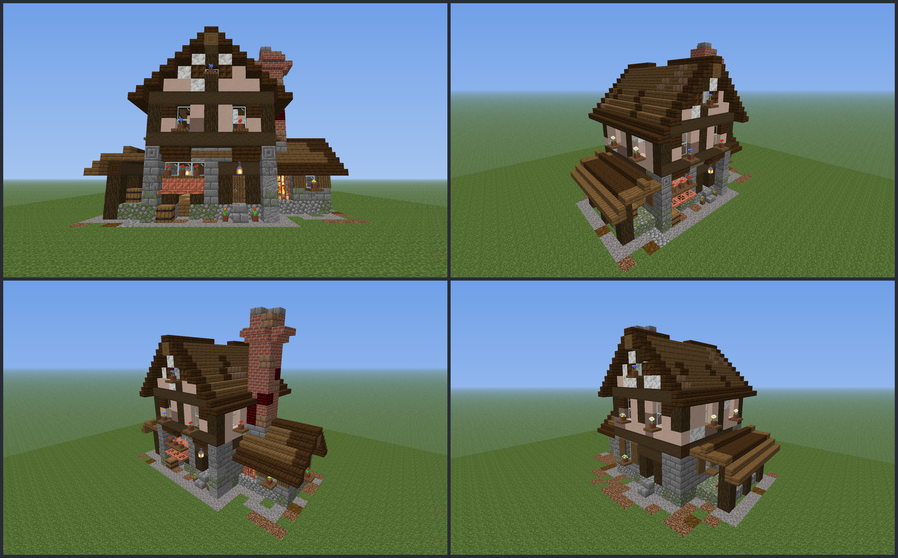

# House design: `factory` cookie works

Status: placeholder (reworked 2026-10-24 for `build-quality`; textured previews and Chunky shots reviewed, needs a look in game)

- **Purpose:** the house `/bakery house place factory` pastes and the build cinematic reveals (GDD §3.1 "the atmospheric little building in which the cookies are baked").
- **Pipeline:** plugin data file, not resource pack. Vanilla blocks only.
- **File:** `src/main/resources/houses/factory.yml`, **generated** by `design/scripts/house_factory.py` (`mise run assets`); layout constants and checks in `design/scripts/factory_layout.py`. Don't edit the YAML by hand. Kits: `design/scripts/lib/build.py`; lint: `design/build-lint.md`; reference sheet: `design/refs-factory.md`.
- **Target:** Paper 26.3 (`26.3.build.205-stable`). Every block data string is a full 26.3 vanilla state (stairs shapes and pane/fence connections computed like the game does on placement); ids and states are also cross-checked against the 26.3 client jar's blockstates. Copper is **waxed**.
- **Size:** `size: [19, 18, 14]` = design box 19 x 17 x 14 above the ground **plus 1 ground layer** (`ground-depth: 1`, design y -1). 965 blocks.
- **Previews (textured, real 26.3 textures):** `design/scripts/previews/house_factory_sheet.png` (front, NE, NW, back), `house_factory_front.png`, `_ne`, `_nw`, `_back`, `_above`; the whole plot with decor and fence: `decor_sheet.png`, `decor_eye.png`, `decor_ne/nw/se/sw.png`. Chunky shots (orchestrator): `~/bakery-review/shots/factory_{eye,34,door}.png`.




## Look
A Norman/Tudor **bakehouse**, three volumes, **one chimney**:
- **Bake hall** (x6..14, z2..10): cobblestone plinth ramp (y0), stone-brick ramp ground storey (y1..4, a string course of stripped dark oak on the sides and back), a **plastered upper floor** (y5..7, plaster ramp in a dark oak frame: log posts at the corners, bay ends and mid-wall, plank braces) with flower-boxed windows, a stripped-log top plate (y8), and a **45 degree roof** (spruce field with mud-brick and dark-oak patches, **dark oak eave and rake**, spruce ridge beam with slab cap, ridge y12). Both gables are plastered, with a king post and a shuttered loft window with a flower box. A **flush copper louvre** sits in the ridge (z5..7).
- **Front (north):** the upper floor is a **1-block jetty** (plane z1 over the ground plane z2) on a stripped-log bressumer, carried by stone pilasters (chiselled caps) and inverted-stair brackets. West bay: spruce door in a dark oak frame with stoop, a hanging lantern on a bracket, potted tulips. A stone post, then the **signboard** (three spruce wall signs at y4). East bay: the **loading hatch** (x12, y0..1) between timber jambs under a copper lintel and awning, a wide flower-boxed window above, a barrel.
- **Oven house** (west lean-to gable, x1..5, z4..8): stone walls, a **cross-gable** roof (ridge along x, y5), the **oven mouth** behind waxed copper bars with a lit campfire, magma and shroomlight, a shuttered flower-boxed window, a window on the west gable.
- **The one chimney:** a 2 x 2 **oven stack** (x4..5, z5..6) from the oven hood: 3 stone courses, a brick shaft (bricks / red nether / mud bricks in clustered quotas), a corbel ring of inverted brick stairs and a two-slab crown, top y14, crown y15; it stands against the hall's west wall and is the only thing above the ridge. The old 16-high boiler stack, the brick duct and the copper steam pipe are gone.
- **Flour shed** (east lean-to, x15..18, z2..8): dark oak posts and beam, stone-brick-wall knee walls, a 26 degree roof with a spruce eave, barrels, flour sacks, a hanging lantern; two lit windows into the hall.
- **Ground (y -1, inside the design box):** a gravel / coarse-dirt apron around the walls with an irregular outer edge, a gravel path from the door and the hatch to the box edge. Everything outside the box is `decor.yml`.

**Rework 2026-10-24 (build-quality):** before it was two chimneys, flat brick walls, a roof covering most of the facade, skylight glass cubes and stray props. Now: R1-R21 of `design/style-guide.md` and the lint pass.

## File format additions (the rest: `design/house-default.md`)
```yaml
ground-depth: 1                        # the first layer is design y -1 (see house-default.md)
points:
  smoke: [[4, 16, 6]]                  # list with ONE entry (R11): the air cell above the oven stack's crown slab
  steam: [[10, 13, 6]]                 # ONE entry: the air cell above the copper ridge louvre (sound anchor)
  belt_out: [12, 0, 1]                 # the first belt cell outside the loading hatch
  door: [8, 1, 2]
layout:                                # plot layout (below)
```
- `points.smoke` / `points.steam` are lists of `[x, y, z]` with **at most one entry** since this rework (R11, lint-enforced). Every smoke point is an air cell with a block right below it (the crown slab); every steam point an air cell right above the louvre.

## Points
| Name | Design cell | Meaning |
|---|---|---|
| `points.smoke[0]` | `[4, 16, 6]` | above the slab crown of the oven stack (`[4, 15, 6]` is a slab; the shaft top is y14); the stack is 2 x 2 (x4..5, z5..6), spread up to 0.4 |
| `points.steam[0]` | `[10, 13, 6]` | above the copper grate louvre in the ridge (`[10, 12, 6]`, z5..7); sound anchor of `factory_ambient` |
| `points.belt_out` | `[12, 0, 1]` | unchanged: first belt cell outside the hatch; the hatch opening is `[12, 0..1, 2]`; belt runs north; copper awning at `[11..13, 1, 1]` |
| `points.door` | `[8, 1, 2]` | unchanged: lower half of the front door |
| `signs[0]` | `[10, 4, 1]`, `["", "Cookie Works", "", ""]` | unchanged: middle wall sign of the signboard (now spruce signs on the stone fascia); the signs beside it stay blank |

Light: the oven (campfire, shroomlight, magma), a lantern on a shelf behind every window, a hanging lantern at the door and in the shed.

## Plot layout (the `layout:` section, contract change 2026-10-20)
The admin draws one WorldGuard region; the plugin builds everything from this fixed layout so every plot looks the same. All cells are relative to the **plot's min corner**: x west → east, z north → south, y 0 = the first air layer above the ground. The front faces north; nothing rotates.

```yaml
layout:
  plot-size: [31, 30]                                 # fenced plot, x by z; the fence is the outer ring
  house-at: [6, 0, 10]                                # design cell [0,0,0] lands here
  pedestal: {at: [18, 0, 6], yaw: 180}                # cookie/pedestal point (bottom centre of the cell)
  shop: {at: [20, 0, 6], yaw: 180}                    # shop panel, 2 east of the pedestal
  clicks: {at: [16, 0, 6], yaw: 180}                  # click upgrades panel + shelf, 2 west of the pedestal (upgrade-holograms)
  viewpoint: {at: [15, 0, 2], yaw: 0, pitch: -14}     # where the player watches the build
  entrance: [15, 0]                                   # centre of the 3-wide gate, front (north) ring
  belt: {from: [18, 0, 11], to: [18, 0, 7]}           # belt cells, from belt_out to the cell before the pedestal
  camera: {at: [23, 12, -13], yaw: 20, pitch: 24}     # optional: build-cinematic eye point (feature conveyor-belt)
```
- **Plot size 31 × 30:** design box 19 × 14 at `house-at`, 5 free blocks between it and the fence on the west, east and south; in front 9 rows hold the belt end, the pedestal, the shop and 5 free rows in front of the pedestal for players clicking it.
- **Belt:** 5 cells, straight north, `from` = `points.belt_out` in plot cells (`house-at + [12, 0, 1]`), `to` = the last belt cell, the one right south of the pedestal (pedestal = `to` − 1 in z). Inclusive both ends.
- **Pedestal / shop:** yaw 180 = facing north, towards the entrance and the players. The shop stands 2 east of the pedestal so it never blocks the belt or the click area.
- **Clicks:** `clicks` mirrors the shop, 2 west of the pedestal (x 16, belt is x 18, so it is 2 clear of the belt and the cookie). The panel hangs above the cell, the upgrade shelf (a small icon grid) goes under it; the cells west of x 16 up to the fence (x 1) are free, so the shelf can grow sideways. Validated like the shop (free at feet and head height, outside the design box, not on the belt).
- **Viewpoint:** 2 blocks inside the gate, centred on the building (design box x 6..24, centre 15.5), looking south (yaw 0) and up 14° (pitch −14). With the default 70° vertical FOV the frame runs from about −21° to +49°: the facade base (−9° at 10 blocks), the front ridge (+48°) and the tall stack top (+37° at ~20 blocks) are all inside; horizontally the 19-wide box spans ±44° (16:9 gives ±51°). Yaw follows Minecraft: 0 = south, 180 = north, pitch negative = up.
- **Viewpoint vs camera:** the viewpoint is where the player stands *after* the build. `camera` (optional, added by `conveyor-belt`) is where the raised build-cinematic camera sits *during* it: a feet cell like the viewpoint (eye = bottom centre + 1.62), all ints, and it **may lie outside the plot** (negative z) and above the ground. The factory's camera is 13 blocks north of the front fence and 12 up, a 3/4 view (yaw 20, pitch 24) that frames the whole factory, belt, pedestal and fence on a 4:3 screen at FOV 70. Details, the framing check and the preview: `design/conveyor-belt.md`. Layouts without `camera` (the cottage) keep the old cinematic.
- **Belt frame:** the belt cells get the frame style `houses/belt.yml` (frame column from y 0 up to `surface-height` − 1, the `cookieclicker:conveyor_belt` surface display on top); format in `design/conveyor-belt.md`.
- **Fence:** the outer ring of `plot-size`, style `houses/fence.yml` (`design/fence.md`), gate centred on `entrance`.
- Validated by the generator: the camera is raised, outside the design box, in the air and frames everything (4:3, FOV 70, 5% margin); the cell above every belt cell is air or a closed top-half trapdoor; all points inside the ring; belt cells free at belt level; pedestal, shop and viewpoint free at feet and head height and outside the design box; belt straight, ≥ 4 long, ends next to the pedestal; ≥ 5 free blocks to the fence (≥ 5 rows in front of the pedestal); entrance on the front ring with the whole gate between the corners and a free walk-in; the hatch behind `belt_out` open.

## Palette
Generated (85 entries; chars are assigned automatically, the YAML has the full list; stairs appear in all needed shapes). Roles: see `design/refs-factory.md` (ramps). Block counts: 965.

## Notes for the other roles
- **plugin-coder:** `ground-depth: 1` (first layer = design y -1: gravel/coarse dirt/podzol/cobblestone only); `points.smoke` / `points.steam` are one-entry lists now (the loop code must not assume two); block entities: 3 wall signs, the campfire, 5 barrels; leaves: none; water: none.
- **vfx-designer:** one stack: 2 x 2 top (`points.smoke[0]` is the NW cell of the crown; spread <= 0.4, centre offset +0.5, +0.5). The steam vent is 1 x 3 along z on the ridge.
- **plugin-tester:** parser cases: `ground-depth` with layers, one-entry smoke/steam lists, the layout unchanged.

## Placeholder / needs a human
- Judged in textured previews and Chunky shots; check in game: the jetty brackets, the sign text on the stone fascia, the oven glow, the smoke from the single stack, the hatch and belt, night light from the 12 window lanterns.
- Weak: the flour shed's roof is plain; no interior furniture beyond the shelves and the oven.
