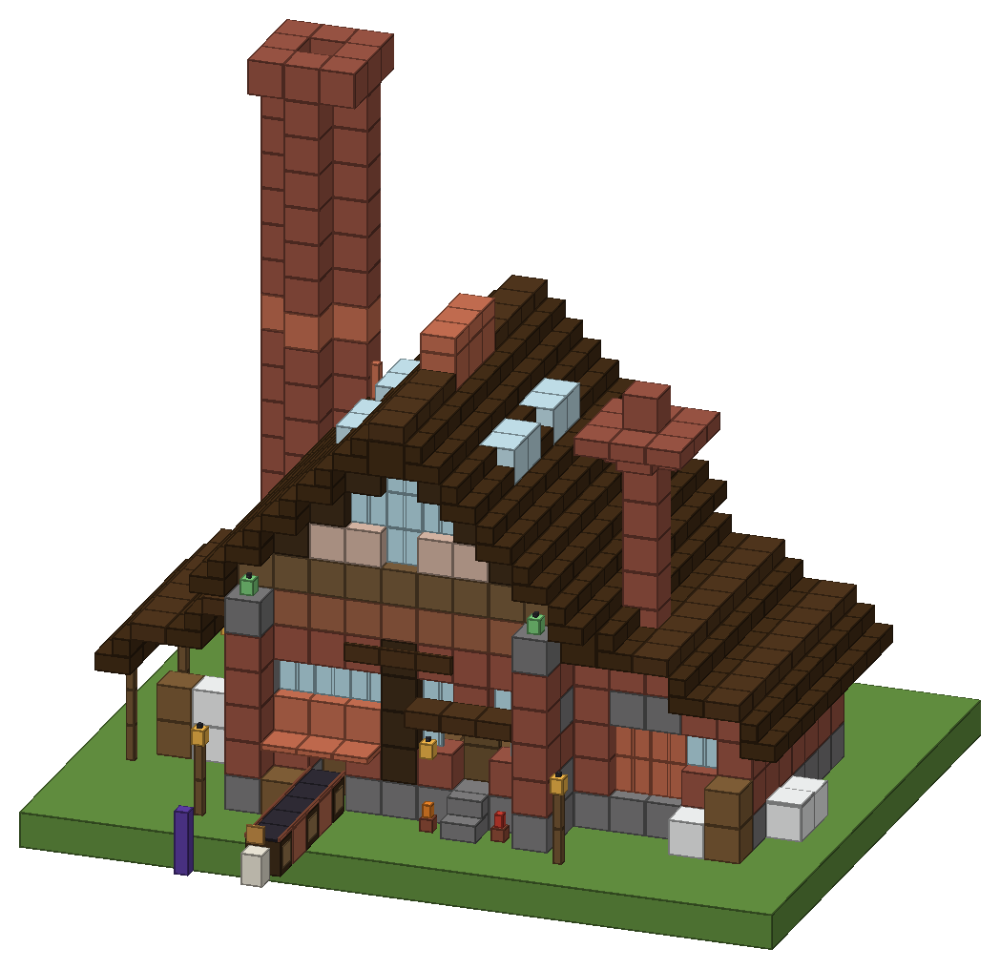
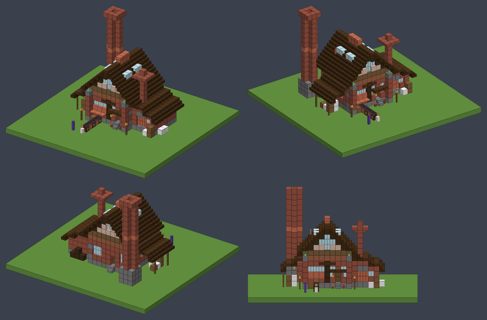
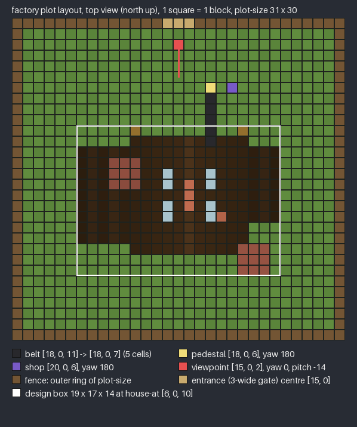
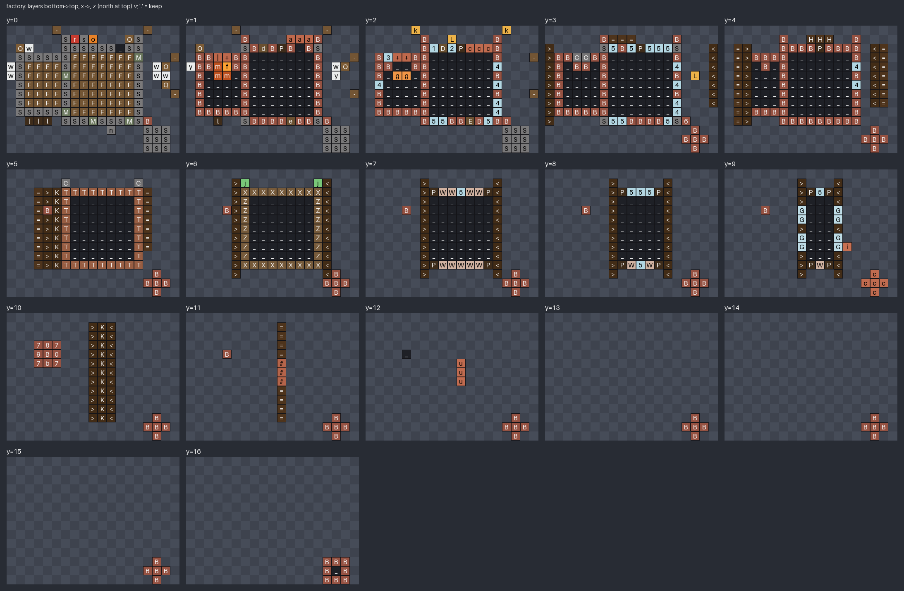

# House design: `factory` cookie works

Status: placeholder (first design; needs a look in game)

- **Purpose:** the house `/bakery house place factory` pastes and the build cinematic reveals (feature `factory-makeover`, GDD §3.1 "the atmospheric little building in which the cookies are baked"). Replaces the cottage as the design the docs and test guide use; `default` stays available.
- **Pipeline:** plugin data file, not resource pack. Vanilla blocks only.
- **File:** `src/main/resources/houses/factory.yml`, **generated** by `design/scripts/house_factory.py` (`mise run assets`). Don't edit the YAML by hand. Validation, YAML writer and preview sheets are shared with the cottage in `design/scripts/lib/house_lib.py` (`default.yml` is byte-identical after the refactor).
- **Target:** Paper 26.3 (`26.3.build.205-stable`). Every block data string is a full 26.3 vanilla state; all block ids were checked against `org/bukkit/Material.java` in the paper-api 26.3 sources jar (2026-10-20), e.g. `waxed_copper_bars`, `waxed_copper_lantern`, `waxed_lightning_rod` (copper blocks are **waxed** so they never oxidise).
- **Previews:** `design/scripts/previews/house_factory_front.png` (front 3/4 from the entrance side), `house_factory_iso.png` (front-west and front-east 3/4, back 3/4, front elevation), `house_factory_layers.png` (every layer with palette chars), `house_factory_plot.png` (top-down plot layout), `house_factory_camera.png` (the build-cinematic view from `layout.camera`, perspective). Preview colours are rough texture averages. The belt is drawn with its `belt.yml` frame and surface; pedestal and shop are markers only.






## Look
A chunky brick-and-timber cookie works, three parts under dark oak roofs:
- **Bake hall** (9 × 9, walls 6 high): stone brick plinth (a few mossy), brick walls with stone quoins on the back corners, a terracotta string course and a stripped spruce top beam. Tall front gable in white terracotta framed by spruce timbers, with a cross-shaped **rose window**. Steep 45° dark oak roof, plank ridge with a slab cap, one block of overhang all round. **Skylights** (glass) in both slopes, a **copper ridge vent** (copper grate louvres under a copper slab cap) and a copper **steam pipe** (waxed lightning rod) on the east slope.
- **Front (north):** brick corner pilasters standing one block proud, each with a copper lantern on a chiselled cap. West bay: spruce door with a stone step, a dark oak canopy and a hanging lantern, windows either side, potted tulips. A spruce post divides the bays. **Signboard** of three dark oak wall signs; the middle one reads "Cookie Works". East bay: the **loading hatch** (1 wide, 2 high, at ground level) under a copper lintel and a copper awning, a wide window over it, a barrel beside it. The belt comes out here (`points.belt_out`).
- **Oven house** (west lean-to, set back one block): the **oven mouth** behind waxed copper bars, with a lit campfire on a magma bed and a glowing shroomlight back wall, under a chiselled lintel. The **short oven stack** (1 × 1, corbelled square cap, top y11) rises straight above the fire. Barrels and flour sacks by the door, firewood under the back eave.
- **Flour shed** (east lean-to on spruce fence posts): barrels, a pile of flour sacks (white wool + carpet), a hanging lantern.
- **Tall boiler stack** (back east): 3 × 3 stone base, rounded "plus" shaft with a copper band at y9, a square crown ring with an open flue at y16, a brick duct to the hall.
- Two lamp posts (fence + lantern) frame the front.
- 796 blocks (air/keep not counted), design box 19 × 17 × 14 = 4,522 cells (limit `house.max-blocks` 40,000).

**Why this size:** the bake hall needs 9 wide to fit door bay + post + hatch bay on one facade with real depth (pilasters, recesses, canopy), and a 45° roof over 9 gives the tall fairy-tale gable that reads as "main building" next to the lean-tos. Everything else hangs off it in lean-tos so the footprint grows sideways, not up. The tall stack is the only thing above the ridge, which makes the silhouette (one tall stack, one short stack, a vent) read as a factory from the plot entrance. Smaller lost the hatch bay or the oven; bigger only added empty wall.

## File format additions (the rest: `design/house-default.md`)
```yaml
points:
  smoke: [[16, 16, 12], [4, 12, 4]]   # list: every point gets the chimney smoke loop
  steam: [[10, 13, 6], [13, 10, 8]]   # optional list: the factory_steam loop
  belt_out: [12, 0, 1]                # the first belt cell outside the loading hatch
  door: [8, 1, 2]
layout:                               # plot layout (see below); cells from the plot's min corner
  plot-size: [31, 30]
  ...
```
- `points.smoke` / `points.steam` are lists of `[x, y, z]`; `points.chimney` (cottage) stays a single `[x, y, z]` = a one-item smoke list. A design may have both styles only across files, not in one file.
- Every smoke point is an air cell with the stack's top block right below it; every steam point is an air cell right above its vent/pipe (the generator checks this).

## Points
| Name | Design cell | Meaning |
|---|---|---|
| `points.smoke[0]` | `[16, 16, 12]` | tall boiler stack: the open flue inside the crown ring, `[16, 15, 12]` is the top brick |
| `points.smoke[1]` | `[4, 12, 4]` | short oven stack: above the top brick `[4, 11, 4]` |
| `points.steam[0]` | `[10, 13, 6]` | above the copper ridge vent cap (`[10, 12, 6]`); the vent is 3 long along z (5..7) |
| `points.steam[1]` | `[13, 10, 8]` | above the copper steam pipe (lightning rod at `[13, 9, 8]`) |
| `points.belt_out` | `[12, 0, 1]` | first belt cell outside the hatch, at ground level (y0 = first air layer above the ground). The hatch opening is `[12, 0..1, 2]`; the belt runs **north (-Z)**, straight. A copper awning sits above it at `[11..13, 1, 1]` (top-half trapdoor, top 1/8 of the cell), so a belt up to ~1.8 high fits. |
| `points.door` | `[8, 1, 2]` | lower half of the front door |
| `signs[0]` | `[10, 4, 1]`, `["", "Cookie Works", "", ""]` | middle wall sign of the signboard, front faces north. The two signs beside it (`[9, 4, 1]`, `[11, 4, 1]`) stay blank on purpose (they make the board). |

`factory_ambient` (sound) plays at `points.steam[0]` per the brief. Light: the oven (campfire, shroomlight, magma), 4 lanterns and 2 copper lanterns light the front at night.

## Plot layout (the `layout:` section, contract change 2026-10-20)
The admin draws one WorldGuard region; the plugin builds everything from this fixed layout so every plot looks the same. All cells are relative to the **plot's min corner**: x west → east, z north → south, y 0 = the first air layer above the ground. The front faces north; nothing rotates.

```yaml
layout:
  plot-size: [31, 30]                                 # fenced plot, x by z; the fence is the outer ring
  house-at: [6, 0, 10]                                # design cell [0,0,0] lands here
  pedestal: {at: [18, 0, 6], yaw: 180}                # cookie/pedestal point (bottom centre of the cell)
  shop: {at: [20, 0, 6], yaw: 180}                    # shop panel, 2 east of the pedestal
  viewpoint: {at: [15, 0, 2], yaw: 0, pitch: -14}     # where the player watches the build
  entrance: [15, 0]                                   # centre of the 3-wide gate, front (north) ring
  belt: {from: [18, 0, 11], to: [18, 0, 7]}           # belt cells, from belt_out to the cell before the pedestal
  camera: {at: [23, 12, -13], yaw: 20, pitch: 24}     # optional: build-cinematic eye point (feature conveyor-belt)
```
- **Plot size 31 × 30:** design box 19 × 14 at `house-at`, 5 free blocks between it and the fence on the west, east and south; in front 9 rows hold the belt end, the pedestal, the shop and 5 free rows in front of the pedestal for players clicking it.
- **Belt:** 5 cells, straight north, `from` = `points.belt_out` in plot cells (`house-at + [12, 0, 1]`), `to` = the last belt cell, the one right south of the pedestal (pedestal = `to` − 1 in z). Inclusive both ends.
- **Pedestal / shop:** yaw 180 = facing north, towards the entrance and the players. The shop stands 2 east of the pedestal so it never blocks the belt or the click area.
- **Viewpoint:** 2 blocks inside the gate, centred on the building (design box x 6..24, centre 15.5), looking south (yaw 0) and up 14° (pitch −14). With the default 70° vertical FOV the frame runs from about −21° to +49°: the facade base (−9° at 10 blocks), the front ridge (+48°) and the tall stack top (+37° at ~20 blocks) are all inside; horizontally the 19-wide box spans ±44° (16:9 gives ±51°). Yaw follows Minecraft: 0 = south, 180 = north, pitch negative = up.
- **Viewpoint vs camera:** the viewpoint is where the player stands *after* the build. `camera` (optional, added by `conveyor-belt`) is where the raised build-cinematic camera sits *during* it: a feet cell like the viewpoint (eye = bottom centre + 1.62), all ints, and it **may lie outside the plot** (negative z) and above the ground. The factory's camera is 13 blocks north of the front fence and 12 up, a 3/4 view (yaw 20, pitch 24) that frames the whole factory, belt, pedestal and fence on a 4:3 screen at FOV 70. Details, the framing check and the preview: `design/conveyor-belt.md`. Layouts without `camera` (the cottage) keep the old cinematic.
- **Belt frame:** the belt cells get the frame style `houses/belt.yml` (frame column from y 0 up to `surface-height` − 1, the `cookieclicker:conveyor_belt` surface display on top); format in `design/conveyor-belt.md`.
- **Fence:** the outer ring of `plot-size`, style `houses/fence.yml` (`design/fence.md`), gate centred on `entrance`.
- Validated by the generator: the camera is raised, outside the design box, in the air and frames everything (4:3, FOV 70, 5% margin); the cell above every belt cell is air or a closed top-half trapdoor; all points inside the ring; belt cells free at belt level; pedestal, shop and viewpoint free at feet and head height and outside the design box; belt straight, ≥ 4 long, ends next to the pedestal; ≥ 5 free blocks to the fence (≥ 5 rows in front of the pedestal); entrance on the front ring with the whole gate between the corners and a free walk-in; the hatch behind `belt_out` open.

## Palette
Generated (55 entries; chars for connection variants are assigned automatically, the YAML has the full list). Main ones:
| Char | Block | Role | Preview colour |
|---|---|---|---|
| `B` | `bricks` | walls, stacks | `#965242` |
| `S` / `M` / `C` | stone / mossy / chiselled stone bricks | plinth, quoins, caps, stack base | `#7A797A` |
| `T` | `terracotta` | string course | `#985E43` |
| `W` | `white_terracotta` | gable infill | `#D1B2A1` |
| `P` `X` `Z` `l` | spruce log / stripped spruce (x, z) / spruce log x | posts, timbers, beams, firewood | `#3E2C1A` / `#765A3A` |
| `F` / `K` | spruce / dark oak planks | floors / ridge | `#735534` / `#422C16` |
| `>` `<` `=` | dark oak stairs (east / west), bottom slab | roofs | `#422C16` |
| `c` `#` `u` `a` `i` `j` | waxed cut copper, copper grate, copper slab, copper trapdoor, lightning rod, copper lantern | copper accents | `#C06B4F` |
| `f` `m` `g` | campfire (lit), magma, shroomlight | the oven glow | `#FAA032` |
| `G` | `glass` | skylights | `#BEDCE6` |
| `H` | `dark_oak_wall_sign[facing=north]` | signboard | `#4E341C` |
| `O` `Q` `w` `y` | barrels, white wool, white carpet | props (crates, flour sacks) | `#7D5C36` / `#EAECEC` |
| digits, `-`, `\|`, `+` | glass panes, copper bars, spruce fences (every connection variant), brick slabs/stairs | windows, oven bars, posts, stack crowns | |

## Notes for the other roles
- **plugin-coder:** parse `points.smoke`/`points.steam` as lists (and `points.chimney` as a one-item smoke list); read the `layout:` section (all ints except yaw/pitch, which may be ints or decimals). Place with physics off like the cottage. Block entities: 3 wall signs, the campfire, 4 barrels (all empty). The campfire is lit and stays lit; it makes its own small smoke inside the oven stack.
- **vfx-designer:** two stacks of different sizes: the tall one has a 1-cell flue inside a 3 × 3 crown (spread ≤ 0.4), the short one a 1 × 1 top (≤ 0.3). Steam vent 0 is a 1 × 3 copper vent along z; steam pipe 1 is a thin rod.
- **plugin-tester:** parser cases: list vs single-point smoke, a steam point list, `layout` present/absent; the factory must validate.

## Placeholder / needs a human
- First pass judged from previews: check in game from the viewpoint (framing, pitch), the roof pitch, the sign text fitting, the oven glow behind the copper bars, campfire smoke inside the stack, and the light level at night.
- Possible polish later: interior machinery (out of scope), window shutters, a few flower boxes.
