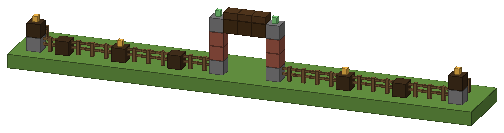

# Plot fence style: `houses/fence.yml`

Status: placeholder (first design; needs a look in game)

- **Purpose:** the look of the fence `/bakery plot fence place` builds on the outer ring of the plot (`layout.plot-size` in `houses/factory.yml`), with the 3-wide gate at `layout.entrance`.
- **File:** `src/main/resources/houses/fence.yml`, **generated** by `design/scripts/fence_style.py` (`mise run assets`); the script checks every block state with the shared `lib/house_lib.py` rules.
- **Preview:** `design/scripts/previews/fence_preview.png` (front ring of the 31-wide factory plot with the gate, seen from outside).
- Only non-directional blocks and vertical logs, so the coder never rotates anything: one style for every side and every polygon corner.



## Look
Spruce fence rails between spruce log posts (every 4th cell), a warm lantern on every 2nd post (one per 8 blocks) and on every corner. Corners are 2-high columns: stone brick base, spruce log on top, lantern. The gate: two brick pillars (stone brick base, two bricks, chiselled stone brick cap, copper lantern on top) either side of a 3-wide, 3-high opening, spanned by a dark oak plank lintel with a slab on top. Same materials as the factory (brick, stone brick, spruce, dark oak, copper).

## Format (contract; the coder parses it, the tester tests the parser)
```yaml
rail: "minecraft:spruce_fence"                        # block id only, no states
post: ["minecraft:spruce_log[axis=y]"]                # column, bottom -> top
post-every: 4
corner: ["minecraft:stone_bricks", "minecraft:spruce_log[axis=y]"]
topper: "minecraft:lantern[hanging=false,waterlogged=false]"
topper-every: 2
gate:
  width: 3
  left:  [stone_bricks, bricks, bricks, chiseled_stone_bricks, waxed_copper_lantern[...]]   # column
  right: [same]
  arch:  [null, null, null, dark_oak_planks, dark_oak_slab[type=bottom,...]]                # per height
```
Every value is a full 26.3 block data string for `Bukkit.createBlockData` (the file spells them out); `null` = air.

**Placement rules**
- **Columns** (`post`, `corner`, `gate.left`, `gate.right`, `gate.arch`) are lists bottom → top; index 0 sits on y 0 = the first air block above the ground surface of that column.
- **Rail:** every ring cell that isn't a corner, post or gate cell gets `rail` at y 0. It has no states in the file: the coder sets `north/east/south/west` from the neighbours after placing the whole ring (a fence connects to fences, fence gates and full solid blocks; all posts, corners and pillars here are full solid blocks), `waterlogged=false`.
- **Corners:** every cell where the ring turns (the 4 corners of `plot-size`; on a polygon every vertex) gets `corner`, then `topper` on top.
- **Posts:** along each side, every `post-every`-th cell counted from that side's starting corner (distance 4, 8, 12, …) gets `post`, except cells within 1 cell of a gate pillar or of a corner (those stay rails). Every `topper-every`-th post of a side (the 2nd, 4th, …) gets `topper` on top of its column.
- **Gate:** centred on `layout.entrance`: the `width` (3) cells of the opening get `gate.arch` (heights 0–2 are `null`, so the opening stays a 3-high walkway), the cell just left of the opening gets `gate.left`, the one just right `gate.right` (left/right as seen from outside; they are identical in this style). The whole gate uses the ground height of the entrance cell, so the lintel stays level.
- Nothing hangs or needs side support: lanterns stand on full blocks or logs, the slab sits on the planks.

## Placeholder / needs a human
- Check in game: post rhythm on the 31 × 30 ring, lantern light along the fence at night, whether the gate lintel at 3 high feels roomy enough.
