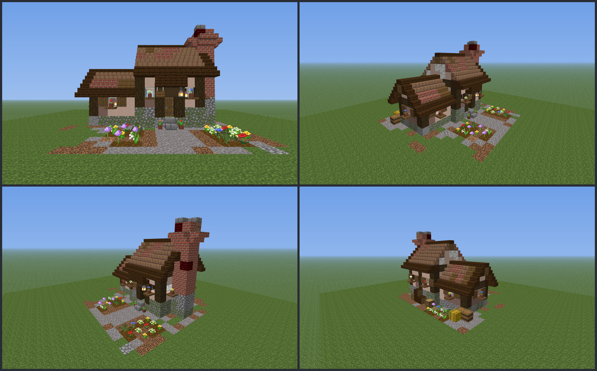

# House design: `default` bakery cottage

Status: placeholder (reworked 2026-10-24 for `build-quality`; textured previews reviewed, needs a look in game)

- **Purpose:** the house `/bakery house place default` pastes into a plot's house region. The build cinematic reveals the same blocks per player, and the chimney smoke starts at `points.chimney`.
- **Pipeline:** plugin data file, not resource pack. Vanilla blocks only, no custom models or textures.
- **File:** `src/main/resources/houses/default.yml`. It is **generated**: edit `design/scripts/house_default.py` and run `mise run assets`. Don't edit the YAML by hand. Reference sheet: `design/refs-default.md`; lint: `design/build-lint.md`.
- **Previews (textured):** `design/scripts/previews/house_default_sheet.png` (front, NE, NW, back), `house_default_front/ne/nw/back/above.png`.
- **Target:** Paper 26.3 (`26.3.build.205-stable`). Every block data string is a full 26.3 vanilla state and goes straight into `Bukkit.createBlockData(String)`; stair shapes and connections are computed like the game does.



## Look
A Tudor bakery cottage in two volumes (R1) with a yard around it:
- **Hall** (walls x3..9, z6..12, ridge along x): two-course cobblestone plinth ramp, plaster ramp walls in a dark oak frame (corner posts, door jambs, mid posts), flower-boxed windows with sills and lit interiors, a dark oak plate (y5), a 45 degree mud-brick roof with brick and spruce patches, dark oak eave and rake, spruce ridge beam with slab cap (ridge y8). Plastered gables with a king post (west gable window with a flower box).
- **Door (front, north):** spruce door in a log frame with a lintel, a stair **hood**, a hanging lantern on its west side, a hanging "Bakery" sign on its east side, a stone step and two potted tulips.
- **Service wing** (x9..14, z7..11, lower, ridge y5, set back one block): shuttered windows on three sides, a plastered east gable.
- **The one chimney** (R11): a 2 x 2 brick stack on the hall's west gable (x1..2, z8..9) from the ground to y10 on a cobblestone base, corbel ring, two-slab crown at y11; smoke above.
- **Yard (ground layer + y >= 0):** a wandering 3-wide gravel path from the door to the north edge, two flower beds either side of it, a gravel/coarse-dirt apron around the walls with an irregular outer edge, a woodpile with a chopping block at the back wall, an herb bed, hay and barrels behind the wing. The front yard (5 deep, 9 wide, 3-wide corridor) is kept clear.
- 657 blocks (air and keep cells not counted), design box 17 x 13 x 15 above the ground + 1 ground layer.

**What changed (2026-10-24):** the old cottage was one 9 x 7 x 7 box with a flat brick chimney. Design box and block count changed: **the shipped-design test in `HouseDesignParserTest` pins the old 9 x 7 x 7 and 170 blocks and must be updated** (REQUEST to plugin-tester).

## File format (contract; the coder parses it, the tester tests the parser)
```yaml
size: [17, 14, 15]       # [x, y, z] cells; y counts the ground layers too
origin: [0, 0, 0]        # design cell (design y!) that lands on the house region's minimum corner
ground-depth: 1          # OPTIONAL, 0..2 (< size[1]); missing = 0 (old files unchanged)
palette:                 # one char -> one block data string
  "S": "minecraft:stone_bricks"
  ...
layers:                  # bottom -> top: size[1] layers; the first ground-depth layers are the ground
  - ["...rso...", ...]   # each layer: size[2] rows (z = 0 first), each row: size[0] chars (x = 0 first)
points:
  chimney: [1, 12, 9]    # design cell where chimney smoke starts (air above the crown slab)
  door: [6, 1, 6]        # lower half of the front door
signs:                   # optional: text to set on sign blocks after placing
  - at: [7, 3, 5]
    lines: ["", "Bakery", "", ""]
```
- **Axes:** x = west to east, y = bottom to top, z = north to south, as in the world. No rotation: the front always faces north (-Z).
- **`ground-depth: N`** (new, contract of `build-quality`, 0..2, `N < size[1]`): the first N entries of `layers` are **ground layers** below the house region's minimum Y; `size[1]` counts them. **Design y counts from the first layer above the ground**, so the ground layers are design y -N..-1, and `points`, `signs[].at` and `origin` use that design y (so existing points do not shift: the door stays `[x, 1, z]`). Layer i (0-based) is design y `i - N`; world y = `regionMin.y + (designY - origin.y)`. Mounds and terraces are ordinary blocks at y >= 0. Ditches and water are air or water in the ground layers; pasted water stays still. The footprint of the ground is the design box itself. `.` keeps the world's block (not changed, not backed up); `_` is air. Everything, ground included, is backed up and restored by `/bakery house undo`.
- **Placement:** physics off. Leaves are forced `persistent=true` by the plugin (the generator also writes `persistent=true`).
- **Points:** `points.chimney` (single, = a one-item smoke list) or `points.smoke` / `points.steam` lists (see `design/factory.md`): at most one entry each (R11).
- Rows are quoted strings (some chars are YAML-special). The palette may contain non-ASCII characters (Latin-1 letters) when a design needs more than ~90 distinct block states; read the file as UTF-8, one char per cell.
- Validation the generator runs before writing (the parser can do the same): palette values match `^minecraft:[a-z0-9_]+(\[...\])?$` with exactly the properties of the block type; `len(layers) == size[1]`, row lengths; every char is `.` or a palette key; `origin` and all points inside the design (y >= 0); the chimney point is an air cell with a block right below it; the door point is the lower door half; signs hold sign blocks; pane/fence/wall connections and **stair shapes equal what the game assigns on placement**; no gravity blocks except gravel in the ground layers; plants have soil; leaves are persistent; `size[0] * size[1] * size[2]` below `house.max-blocks`.

## Site the admin needs
- House region at least 17 x 13 x 15 (x, y, z, above the ground) **with the region's min Y = the first air layer above the ground** and one more layer of existing ground below it (the ground layer the design rewrites). The design starts at the region's minimum corner. The front (north) side stays clear: cells marked `.` keep whatever is there.
- Nothing needs support from outside the design.

## Points and signs
| Name | Design cell | Meaning |
|---|---|---|
| `points.chimney` | `[1, 12, 9]` | air above the crown slab of the stack (`[1, 11, 9]` is the slab); smoke and the crackle loop start here; the stack is 2 x 2 (x1..2, z8..9) |
| `points.door` | `[6, 1, 6]` | lower door half |
| `signs[0]` | `[7, 3, 5]`, lines `["", "Bakery", "", ""]` | the hanging sign east of the door hood (`rotation=8`, front faces north); plain text, set on the front side |

Block entities: the hanging sign, 4 barrels, barrel/hay in the yard. Nothing contains items.

## Palette and ramps
See `design/refs-default.md`. 71 palette entries (generated; stairs in all shapes).

## Notes for the other roles
- **plugin-coder:** layers bottom to top, rows z = 0 first, chars x = 0 first; ground layers first. Skip `.`. Physics off. Parse `ground-depth` (new) and apply design y offset as above.
- **vfx-designer:** smoke from `points.chimney`: a 2 x 2 top (NW cell given), spread <= 0.4, offset +0.5.
- **plugin-tester:** update the pinned default test (size `17, 14, 15`, 657 blocks, `points.chimney` present, one sign, `ground-depth` 1).

## Placeholder / needs a human
- Judged from textured previews (the review tool's default camera sits inside layout-less designs, so no Chunky shots of the cottage). Check in game: the roof pitch, the hanging sign text, the hood, lantern light at night, the yard path.
