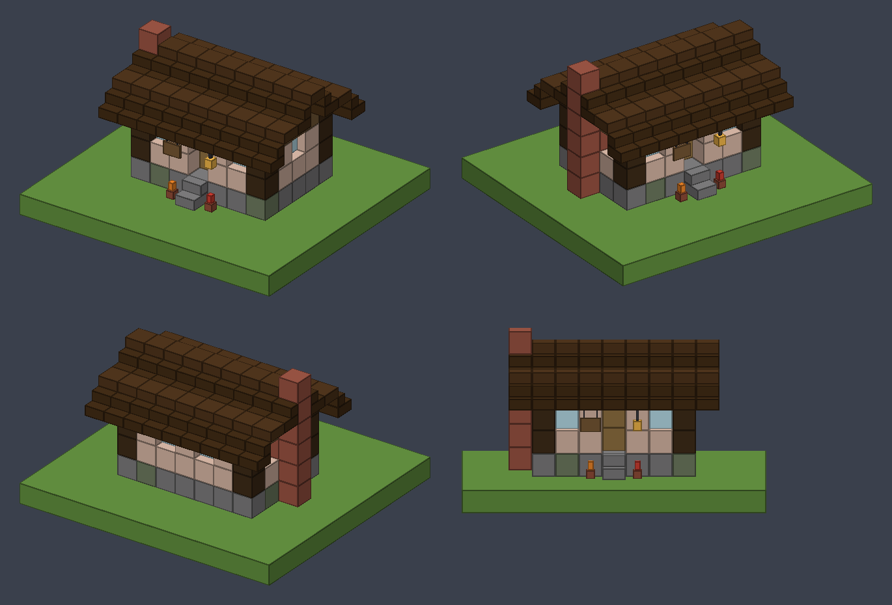
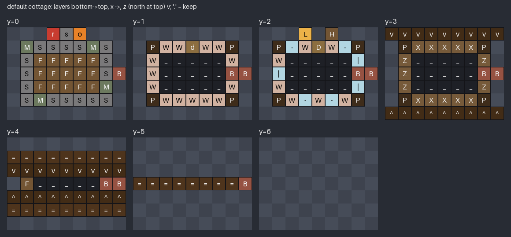

# House design: `default` bakery cottage

Status: placeholder (first design; needs a look in game)

- **Purpose:** the house `/bakery house place default` pastes into a plot's house region (feature `starter-house`). The build cinematic reveals the same blocks per player, and the chimney smoke starts at `points.chimney`.
- **Pipeline:** plugin data file, not resource pack. Vanilla blocks only, no custom models or textures.
- **File:** `src/main/resources/houses/default.yml`. It is **generated**: edit `design/scripts/house_default.py` and run `mise run assets` (or `python design/scripts/house_default.py` from the repo root). Don't edit the YAML by hand.
- **Previews:** `design/scripts/previews/house_default_iso.png` (3/4 views from the front-west, front-east and back-east, plus a front elevation) and `design/scripts/previews/house_default_layers.png` (top view of every layer with the palette chars). The colours there are rough averages of the vanilla textures, for the preview only.
- **Target:** Paper 26.3 (`26.3.build.205-stable`). Every block data string is a full 26.3 vanilla state (all properties written out) and goes straight into `Bukkit.createBlockData(String)`.




## Look
A small timber-framed bakery cottage, 7 × 5 body under a shallow dark oak roof that overhangs one block all round.
- Stone brick plinth (a few mossy bricks) with a stone brick step up to the door.
- Walls: spruce log corner posts, white terracotta infill, stripped spruce top beam. Glass pane windows: 2 at the front, 2 at the back, 1 on the west gable, 2 on the east gable either side of the chimney breast.
- Oak door in the middle of the front (north) wall, recessed (the door plate sits on the inner side of the wall).
- Under the front eave: a hanging lantern west of the door and a spruce hanging sign reading "Bakery" east of it (seen from the front: sign left, lantern right), and potted red and orange tulips either side of the step.
- Shallow roof: alternating dark oak stairs and bottom slabs (half-block steps), slab ridge at y5.
- Brick chimney outside the east gable (`x=8, z=3`), through the roof overhang, from the ground to y5. Its top stands half a block above the slab ridge.
- Inside: spruce plank floor, empty room (y1–y3) plus a small attic gap under the ridge. Furniture is out of scope.
- 170 blocks (air and keep cells not counted), well under the 2,000 limit.

## File format (contract; the coder parses it, the tester tests the parser)
```yaml
size: [9, 7, 7]          # [x, y, z] cells
origin: [0, 0, 0]        # design cell that lands on the house region's minimum corner
palette:                 # one char -> one block data string
  "S": "minecraft:stone_bricks"
  ...
layers:                  # bottom -> top: size[1] layers
  - ["...rso...", ...]   # each layer: size[2] rows (z = 0 first), each row: size[0] chars (x = 0 first)
points:
  chimney: [8, 6, 3]     # design cell where chimney smoke starts (the cell just above the chimney top)
  door: [4, 1, 1]        # lower half of the front door (optional for the coder)
signs:                   # optional: text to set on sign blocks after placing
  - at: [5, 2, 0]
    lines: ["", "Bakery", "", ""]
```
- **Axes:** x = west → east, y = bottom → top, z = north → south, the same directions as world coordinates. No rotation: the front (door, sign) always faces **north (-Z)**. Rotating designs is not part of this format.
- **Placement:** world position of a cell = `regionMin + (cell - origin)`. With `origin: [0, 0, 0]` cell `[0,0,0]` is the region's minimum corner. `points` and `signs[].at` are design cells too: convert them the same way (the smoke spawns at the cell's centre or bottom centre, as the vfx-designer prefers).
- **`.` = keep:** the existing world block stays (not changed, not backed up). `.` is reserved and never in the palette.
- **`_` = air:** cleared on purpose (the room inside, the attic gap). It is a normal palette entry (`minecraft:air`).
- Rows are quoted strings because some chars are YAML-special (`-`, `|`, `^`, `=`). Parse them as plain strings, one char per cell.
- Validation the generator runs before writing (the parser can do the same): every palette value matches `^minecraft:[a-z0-9_]+(\[[a-z0-9_]+=[a-z0-9_]+(,…)*\])?$` and has exactly the properties/values of its block type; `len(layers) == size[1]`, every layer has `size[2]` rows of `size[0]` chars; every char is `.` or a palette key; `origin` and all points are inside `size`; the chimney point is a keep/air cell with the chimney's brick right below it; the door point is the lower door half; every sign position holds a sign block; pane connections match their neighbours; no gravity blocks; fewer than 2,000 blocks.

## Site the admin needs
- House region at least 9 × 7 × 7 (x × y × z). With `/bakery house place` the design starts at the region's **minimum corner**, so make the region's min Y the **first air layer above the ground**: the plinth (y0) then sits on the ground, and the step and flower pots stand on it.
- Keep the 9 × 7 footprint and the front (north) side clear: cells marked `.` keep whatever is there (grass, flowers), which is intended under the roof overhang.
- Nothing needs support from outside the design. The door stands on the plinth; the lantern and the hanging sign hang from the front eave stairs (bottom-half stairs have a full bottom face). Flower pots need no support in vanilla. No gravity blocks.

## Palette
| Char | Block data | Role | Preview colour |
|---|---|---|---|
| `_` | `minecraft:air` | room, attic | — |
| `S` | `minecraft:stone_bricks` | plinth | `#7A797A` |
| `M` | `minecraft:mossy_stone_bricks` | plinth accents | `#6C795E` |
| `s` | `minecraft:stone_brick_stairs[facing=south,half=bottom,shape=straight,waterlogged=false]` | front step | `#7A797A` |
| `F` | `minecraft:spruce_planks` | floor, west gable fill | `#735534` |
| `P` | `minecraft:spruce_log[axis=y]` | corner posts | `#3E2C1A` |
| `X` | `minecraft:stripped_spruce_log[axis=x]` | top beam (front/back) | `#765A3A` |
| `Z` | `minecraft:stripped_spruce_log[axis=z]` | top beam (gables) | `#765A3A` |
| `W` | `minecraft:white_terracotta` | wall infill | `#D1B2A1` |
| `B` | `minecraft:bricks` | chimney + breast | `#965242` |
| `-` | `minecraft:glass_pane[east=true,north=false,south=false,waterlogged=false,west=true]` | front/back windows | `#B2D6E2` |
| `\|` | `minecraft:glass_pane[east=false,north=true,south=true,waterlogged=false,west=false]` | gable windows | `#B2D6E2` |
| `d` | `minecraft:oak_door[facing=north,half=lower,hinge=left,open=false,powered=false]` | door, lower | `#8C6E40` |
| `D` | `minecraft:oak_door[facing=north,half=upper,hinge=left,open=false,powered=false]` | door, upper | `#8C6E40` |
| `v` | `minecraft:dark_oak_stairs[facing=south,half=bottom,shape=straight,waterlogged=false]` | roof, front slope | `#422C16` |
| `^` | `minecraft:dark_oak_stairs[facing=north,half=bottom,shape=straight,waterlogged=false]` | roof, back slope | `#422C16` |
| `=` | `minecraft:dark_oak_slab[type=bottom,waterlogged=false]` | roof steps, ridge | `#4E341C` |
| `L` | `minecraft:lantern[hanging=true,waterlogged=false]` | porch light | `#ECB248` |
| `H` | `minecraft:spruce_hanging_sign[attached=false,rotation=8,waterlogged=false]` | shop sign (front faces north) | `#735534` |
| `r` | `minecraft:potted_red_tulip` | entrance pot | `#C83C30` |
| `o` | `minecraft:potted_orange_tulip` | entrance pot | `#E88228` |

## Points and signs
| Name | Design cell | Meaning |
|---|---|---|
| `points.chimney` | `[8, 6, 3]` | first cell above the chimney top (`[8, 5, 3]` is the top brick); smoke and the crackle loop start here |
| `points.door` | `[4, 1, 1]` | lower door half (optional; e.g. for a "welcome" effect or keep-out checks) |
| `signs[0]` | `[5, 2, 0]`, lines `["", "Bakery", "", ""]` | **optional for the coder.** Plain text, not MiniMessage. Set it on the sign's **front** side (rotation 8 = front faces north) after placing the blocks, e.g. `sign.getSide(Side.FRONT).line(1, Component.text("Bakery"))` + `update()`. The cinematic resends the sign's real tile data with `sendBlockUpdate` (research: fake-blocks). |

The only block entity is the hanging sign. Nothing contains items.

## Notes for the other roles
- **plugin-coder:** layers are bottom → top, rows z = 0 first, chars x = 0 first. Read every palette value with `Bukkit.createBlockData`; skip `.` entirely (no backup, no change). Place with physics off (`setBlockData(data, false)`) so the door halves and pane states stay as written. The reveal can use the same order for every non-`.` cell; `_` cells count as part of the house (fake air is air anyway).
- **vfx-designer:** smoke starts at `points.chimney`; the chimney is 1 × 1, so a small column spread (≤ 0.3) looks right. The y6 layer is empty: it exists so the smoke cell is inside the design bounds.
- **plugin-tester:** parser test cases worth covering: `.` vs `_`, quoted special chars (`-`, `|`, `^`, `=`), wrong row length, unknown char, point out of bounds.

## Placeholder / needs a human
- The whole design is a first pass judged from previews: check it in game (proportions, how the shallow roof reads, the sign text fitting a hanging sign, the lantern light by the door).
- Possible later polish: window shutters (spruce trapdoors), a smoker or oven inside, a lighter roof trim. Interior furniture is out of scope for `starter-house`.
