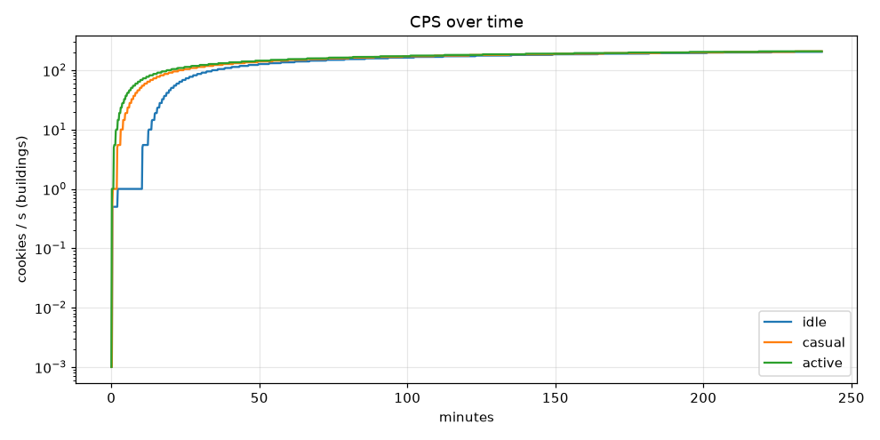
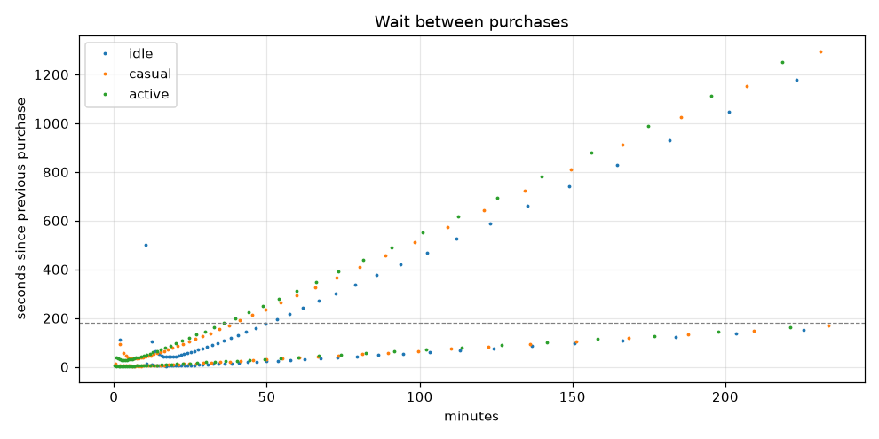
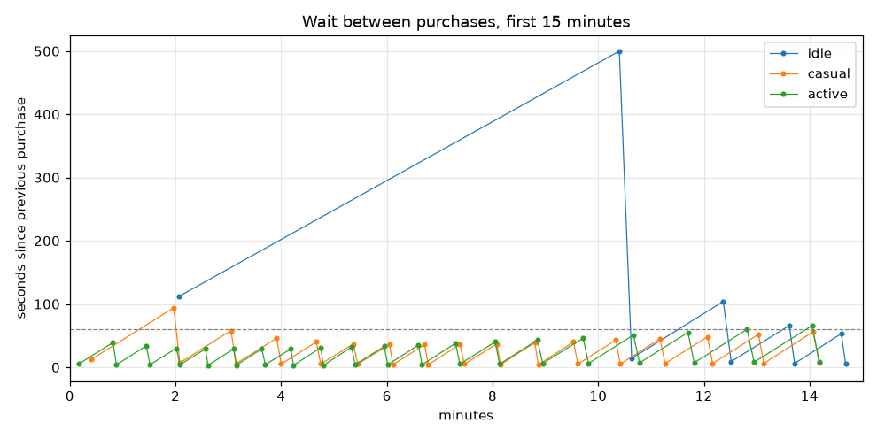

# Balance report 2026-10-18

Configs: `buildings.yml`, `upgrades.yml` · horizon 240 min · targets: 6/6 pass

Click: base power 1, crit 5% × 10 → expected 1.45 × click power

## Targets

| Target | Profile | Result | Limit | |
|---|---|---|---|---|
| first-villager-baker | casual | 12s | 20s | ✅ |
| first-villager-baker | active | 5s | 20s | ✅ |
| first-wheat-farm | casual | 1m58s | 3m00s | ✅ |
| first-wheat-farm | active | 49s | 3m00s | ✅ |
| no-dead-zones-early | casual | 25s | 1m00s | ✅ |
| no-dead-zones-early | active | 18s | 1m00s | ✅ |

## Time to Nth building

| Building | idle #1 | idle #10 | idle #25 | idle #50 | idle #100 | casual #1 | casual #10 | casual #25 | casual #50 | casual #100 | active #1 | active #10 | active #25 | active #50 | active #100 |
|---|---|---|---|---|---|---|---|---|---|---|---|---|---|---|---|
| villager_baker | 12s | 17m52s | 36m12s | never | never | 12s | 7m28s | 24m42s | never | never | 5s | 4m48s | 20m32s | never | never |
| wheat_farm | 10m24s | 19m21s | 40m37s | never | never | 1m58s | 8m48s | 28m58s | never | never | 49s | 5m57s | 24m31s | never | never |

## Upgrades

| Upgrade | idle | casual | active |
|---|---|---|---|

## Per profile

| Profile | Purchases | Longest dead zone (first 15 min) | Longest dead zone | Longest gap between purchases | Final CPS |
|---|---|---|---|---|---|
| idle | 92 | 2m59s | 5m28s | 19m37s | 203.5 |
| casual | 94 | 25s | 6m01s | 21m36s | 208.0 |
| active | 94 | 18s | 5m50s | 20m52s | 208.0 |

## First 15 minutes (purchases)

| Profile | Purchases (time: id #owned) |
|---|---|
| idle | 12s: villager_baker #1, 2m04s: villager_baker #2, 10m24s: wheat_farm #1, 10m38s: villager_baker #3, 12m22s: wheat_farm #2, 12m31s: villager_baker #4, 13m37s: wheat_farm #3, 13m43s: villager_baker #5, 14m36s: wheat_farm #4, 14m41s: villager_baker #6 |
| casual | 12s: villager_baker #1, 24s: villager_baker #2, 1m58s: wheat_farm #1, 2m05s: villager_baker #3, 3m03s: wheat_farm #2, 3m09s: villager_baker #4, 3m55s: wheat_farm #3, 4m00s: villager_baker #5, 4m40s: wheat_farm #4, 4m45s: villager_baker #6, 5m22s: wheat_farm #5, 5m27s: villager_baker #7, 6m03s: wheat_farm #6, 6m07s: villager_baker #8, 6m43s: wheat_farm #7, 6m47s: villager_baker #9, 7m23s: wheat_farm #8, 7m28s: villager_baker #10, 8m05s: wheat_farm #9, 8m09s: villager_baker #11, 8m48s: wheat_farm #10, 8m52s: villager_baker #12, 9m32s: wheat_farm #11, 9m37s: villager_baker #13, 10m20s: wheat_farm #12, 10m25s: villager_baker #14, 11m10s: wheat_farm #13, 11m16s: villager_baker #15, 12m04s: wheat_farm #14, 12m10s: villager_baker #16, 13m02s: wheat_farm #15, 13m08s: villager_baker #17, 14m04s: wheat_farm #16, 14m11s: villager_baker #18 |
| active | 5s: villager_baker #1, 10s: villager_baker #2, 49s: wheat_farm #1, 53s: villager_baker #3, 1m27s: wheat_farm #2, 1m31s: villager_baker #4, 2m01s: wheat_farm #3, 2m05s: villager_baker #5, 2m34s: wheat_farm #4, 2m37s: villager_baker #6, 3m06s: wheat_farm #5, 3m09s: villager_baker #7, 3m38s: wheat_farm #6, 3m42s: villager_baker #8, 4m11s: wheat_farm #7, 4m14s: villager_baker #9, 4m45s: wheat_farm #8, 4m48s: villager_baker #10, 5m20s: wheat_farm #9, 5m24s: villager_baker #11, 5m57s: wheat_farm #10, 6m01s: villager_baker #12, 6m36s: wheat_farm #11, 6m40s: villager_baker #13, 7m18s: wheat_farm #12, 7m23s: villager_baker #14, 8m03s: wheat_farm #13, 8m08s: villager_baker #15, 8m51s: wheat_farm #14, 8m57s: villager_baker #16, 9m43s: wheat_farm #15, 9m49s: villager_baker #17, 10m40s: wheat_farm #16, 10m47s: villager_baker #18, 11m42s: wheat_farm #17, 11m49s: villager_baker #19, 12m49s: wheat_farm #18, 12m57s: villager_baker #20, 14m03s: wheat_farm #19, 14m11s: villager_baker #21 |

## Plots

## Notes (bakery-core, written by hand)

- **Targets replaced:** `first-building-fast` (30 s), `all-tiers-in-2h` and `no-dead-zones` (180 s over the full 4 h) were generic placeholders. The user's bakery-core targets replace them: first Villager Baker ≤ 20 s, first Wheat Farm ≤ 3 min, no dead zone > 60 s in the first 15 min (casual + active). With only 2 buildings and no upgrades, gaps grow past 3 min after ~40 min, so a full-horizon dead-zone target can't hold for this slice. It should come back once more tiers or upgrades land. Profiles are unchanged.
- **Margins (casual):** Villager Baker 12 s / 20 s (40 %), Wheat Farm 1m58s / 3m (34 %), early dead zone 25 s / 60 s (58 %). Active has more.
- **Casual 94 s gap at ~2 min** (early plot): the player saves for the first Wheat Farm while Villager Baker #3 is affordable. That's a choice, not a dead zone.
- **Idle** (no clicks after the first building) is slower but doesn't stall: first Farm at 10m24s, longest dead zone in the first 15 min 2m59s (not targeted).
- **Iterations** (one lever each, casual): Villager Baker cost 15 → early dead zone 56 s (almost fails); 80 → first Villager Baker 19 s (no margin); Wheat Farm cost 1000 → Farm 3m42s and dead zone 1m39s (FAIL); Farm CPS 6 → Farm dominates; growth 1.12/1.18 → ≤ 4 s change; no crit → Farm 2m39s. The baseline was kept.
