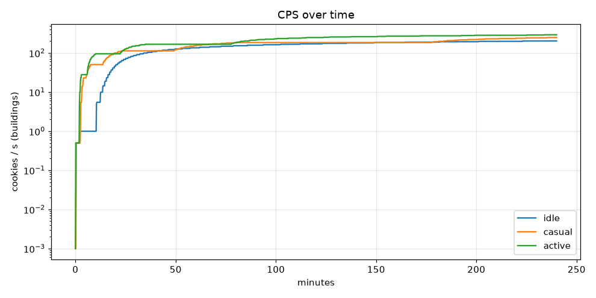
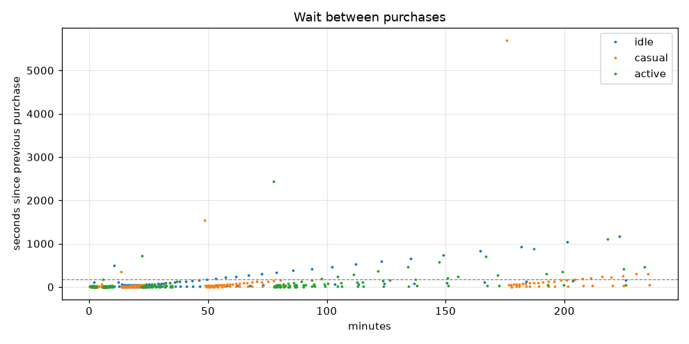
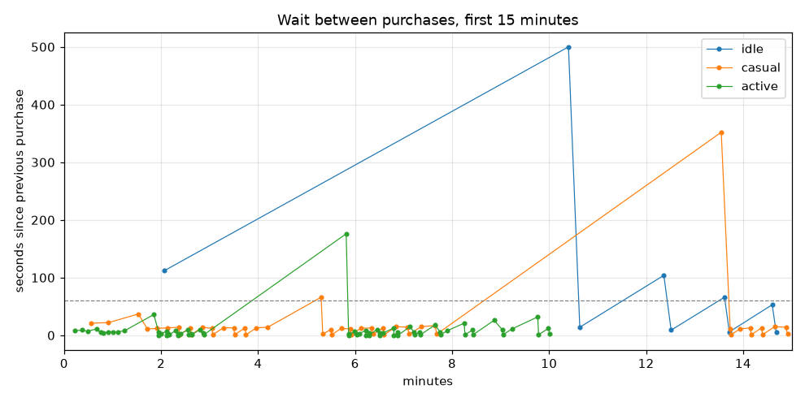

# Balance report 2026-10-21

Configs: `buildings.yml`, `upgrades.yml` · horizon 240 min · targets: 6/6 pass

Click: base power 1, crit 5% × 10 → expected 1.45 × click power

## Targets

| Target | Profile | Result | Limit | |
|---|---|---|---|---|
| first-villager-baker | casual | 12s | 20s | ✅ |
| first-villager-baker | active | 5s | 20s | ✅ |
| first-wheat-farm | casual | 2m36s | 3m00s | ✅ |
| first-wheat-farm | active | 2m00s | 3m00s | ✅ |
| no-dead-zones-early | casual | 12s | 1m00s | ✅ |
| no-dead-zones-early | active | 5s | 1m00s | ✅ |

## Time to Nth building

| Building | idle #1 | idle #10 | idle #25 | idle #50 | idle #100 | casual #1 | casual #10 | casual #25 | casual #50 | casual #100 | active #1 | active #10 | active #25 | active #50 | active #100 |
|---|---|---|---|---|---|---|---|---|---|---|---|---|---|---|---|
| villager_baker | 12s | 17m52s | 36m12s | never | never | 12s | 6m22s | 20m46s | 3h13m25s | never | 5s | 6m02s | 22m36s | 1h30m12s | never |
| wheat_farm | 10m24s | 19m21s | 40m37s | never | never | 2m36s | 7m05s | 22m59s | 3h21m04s | never | 2m00s | 6m17s | 23m09s | 1h34m40s | never |

## Upgrades

| Upgrade | idle | casual | active |
|---|---|---|---|
| bakers_strength | never (level 0 at end) | 55s (level 39 at end) | 22s (level 49 at end) |
| wooden_spatula | never | 33s | 13s |
| stone_rolling_pin | never | 1m32s | 40s |
| iron_rolling_pin | never | 5m18s | 1m51s |
| golden_glove | never | 13m33s | 5m49s |
| diamond_fingers | never | 48m36s | 22m09s |
| netherite_hands | never | 2h55m48s | 1h17m36s |
| handy_fingers_1 | never | never | never |
| handy_fingers_2 | never | never | never |
| handy_fingers_3 | never | never | never |

## Per profile

| Profile | Purchases | Longest dead zone (first 15 min) | Longest dead zone | Longest gap between purchases | Final CPS |
|---|---|---|---|---|---|
| idle | 92 | 2m59s | 2m59s | 19m37s | 203.5 |
| casual | 157 | 12s | 1m26s | 1h35m00s | 248.5 |
| active | 186 | 5s | 1m56s | 40m43s | 293.0 |

## First 15 minutes (purchases)

| Profile | Purchases (time: id #owned) |
|---|---|
| idle | 12s: villager_baker #1, 2m04s: villager_baker #2, 10m24s: wheat_farm #1, 10m38s: villager_baker #3, 12m22s: wheat_farm #2, 12m31s: villager_baker #4, 13m37s: wheat_farm #3, 13m43s: villager_baker #5, 14m36s: wheat_farm #4, 14m41s: villager_baker #6 |
| casual | 12s: villager_baker #1, 33s: wooden_spatula #1, 55s: bakers_strength #1, 1m32s: stone_rolling_pin #1, 1m43s: bakers_strength #2, 1m55s: bakers_strength #3, 2m08s: bakers_strength #4, 2m22s: bakers_strength #5, 2m23s: villager_baker #2, 2m36s: wheat_farm #1, 2m37s: villager_baker #3, 2m51s: bakers_strength #6, 3m03s: wheat_farm #2, 3m04s: villager_baker #4, 3m17s: wheat_farm #3, 3m30s: bakers_strength #7, 3m31s: villager_baker #5, 3m44s: wheat_farm #4, 3m45s: villager_baker #6, 3m58s: wheat_farm #5, 4m12s: bakers_strength #8, 5m18s: iron_rolling_pin #1, 5m20s: villager_baker #7, 5m30s: wheat_farm #6, 5m31s: villager_baker #8, 5m43s: bakers_strength #9, 5m54s: wheat_farm #7, 5m55s: villager_baker #9, 6m07s: wheat_farm #8, 6m20s: bakers_strength #10, 6m22s: villager_baker #10, 6m35s: wheat_farm #9, 6m36s: villager_baker #11, 6m51s: bakers_strength #11, 7m05s: wheat_farm #10, 7m07s: villager_baker #12, 7m22s: wheat_farm #11, 7m39s: bakers_strength #12, 7m41s: villager_baker #13, 13m33s: golden_glove #1, 13m44s: wheat_farm #12, 13m45s: villager_baker #14, 13m56s: wheat_farm #13, 14m09s: bakers_strength #13, 14m10s: villager_baker #15, 14m23s: wheat_farm #14, 14m24s: villager_baker #16, 14m39s: bakers_strength #14, 14m53s: wheat_farm #15, 14m55s: villager_baker #17 |
| active | 5s: villager_baker #1, 13s: wooden_spatula #1, 22s: bakers_strength #1, 29s: bakers_strength #2, 40s: stone_rolling_pin #1, 45s: bakers_strength #3, 49s: bakers_strength #4, 55s: bakers_strength #5, 1m01s: bakers_strength #6, 1m07s: bakers_strength #7, 1m15s: bakers_strength #8, 1m51s: iron_rolling_pin #1, 1m57s: bakers_strength #9, 1m57s: villager_baker #2, 2m00s: wheat_farm #1, 2m07s: bakers_strength #10, 2m07s: villager_baker #3, 2m09s: wheat_farm #2, 2m10s: villager_baker #4, 2m18s: bakers_strength #11, 2m21s: wheat_farm #3, 2m21s: villager_baker #5, 2m24s: wheat_farm #4, 2m33s: bakers_strength #12, 2m34s: villager_baker #6, 2m37s: wheat_farm #5, 2m38s: villager_baker #7, 2m48s: bakers_strength #13, 2m52s: wheat_farm #6, 2m53s: villager_baker #8, 5m49s: golden_glove #1, 5m52s: wheat_farm #7, 5m52s: villager_baker #9, 5m59s: bakers_strength #14, 6m01s: wheat_farm #8, 6m02s: villager_baker #10, 6m05s: wheat_farm #9, 6m13s: bakers_strength #15, 6m13s: villager_baker #11, 6m17s: wheat_farm #10, 6m17s: villager_baker #12, 6m27s: bakers_strength #16, 6m31s: wheat_farm #11, 6m31s: villager_baker #13, 6m35s: wheat_farm #12, 6m48s: bakers_strength #17, 6m48s: villager_baker #14, 6m53s: wheat_farm #13, 6m53s: villager_baker #15, 7m08s: bakers_strength #18, 7m13s: wheat_farm #14, 7m14s: villager_baker #16, 7m20s: wheat_farm #15, 7m21s: villager_baker #17, 7m39s: bakers_strength #19, 7m45s: wheat_farm #16, 7m46s: villager_baker #18, 7m54s: wheat_farm #17, 8m15s: bakers_strength #20, 8m16s: villager_baker #19, 8m25s: wheat_farm #18, 8m26s: villager_baker #20, 8m52s: bakers_strength #21, 9m02s: wheat_farm #19, 9m03s: villager_baker #21, 9m14s: wheat_farm #20, 9m46s: bakers_strength #22, 9m47s: villager_baker #22, 9m59s: wheat_farm #21, 10m01s: villager_baker #23 |

## Plots

## Notes (upgrade-holograms)
- Changes since `report-2026-10-18.md`: GDD §4.4 click tools at the GDD prices (each unlocks at about half its price; the first two after the first Villager Baker), repeatable `bakers_strength` (200, ×1.25 per level, max-level 50, +1 CPC per level), bulk cost rounded once, Max affordable in closed form. Buildings unchanged.
- Before → after (casual / active): first Villager Baker 12 s / 5 s → 12 s / 5 s; first Wheat Farm 1m58s / 49 s → 2m36s / 2m00s (active players now buy click tools first); longest early dead zone 25 s / 18 s → 12 s / 5 s.
- The large single spikes in the gaps plot are the buyer saving for Diamond Fingers / Netherite Hands while cheaper items are affordable, not dead zones (longest dead zone over 4 h: 86 s casual, 116 s active).
- Handy Fingers I–III are not reached within 4 h on two buildings; they're meant for the later building roster.
