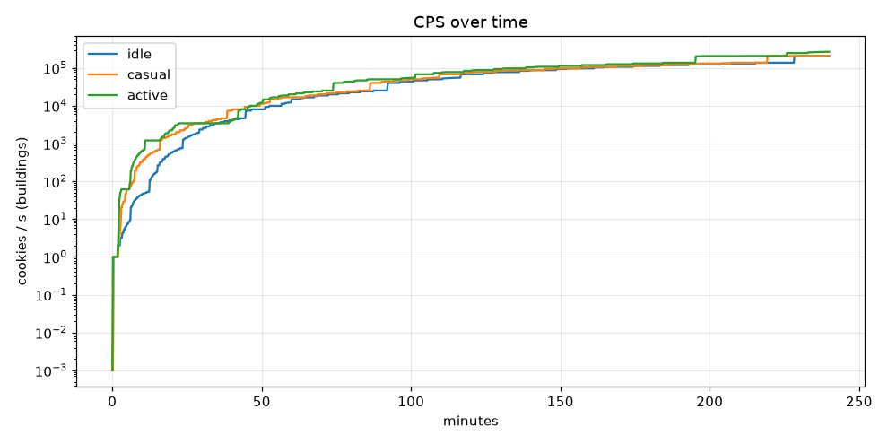
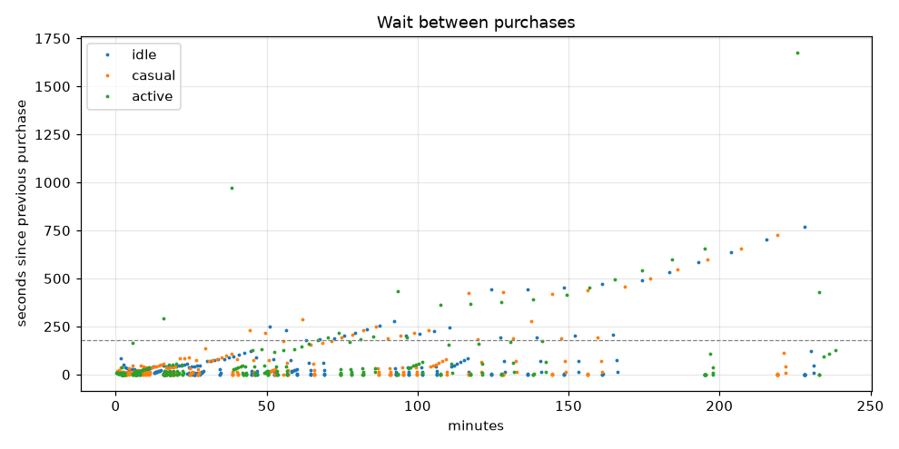
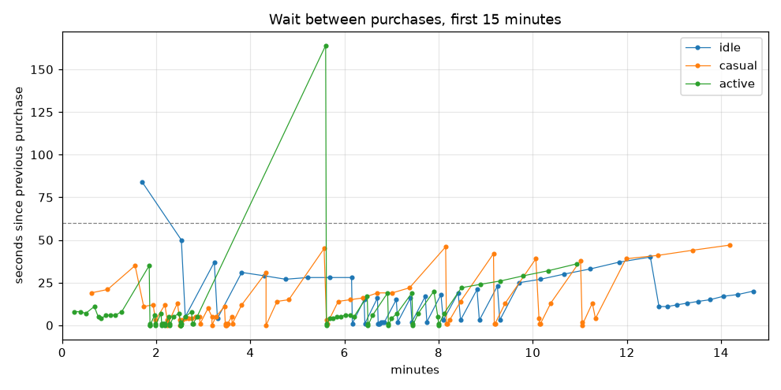

# Balance report 2026-10-22

Configs: `buildings.yml`, `upgrades.yml` · horizon 240 min · targets: 19/19 pass

Click: base power 1, crit 5% × 10 → expected 1.45 × click power

Milestones: ×2 per building at 10, 25, 50, 100, 150, 200 owned

## Targets

| Target | Profile | Result | Limit | |
|---|---|---|---|---|
| first-villager-baker | casual | 18s | ≤ 20s | ✅ |
| first-villager-baker | active | 7s | ≤ 20s | ✅ |
| first-wheat-farm | casual | 2m14s | ≤ 3m00s | ✅ |
| first-wheat-farm | active | 1m52s | ≤ 3m00s | ✅ |
| no-dead-zones-early | casual | 5s | ≤ 1m00s | ✅ |
| no-dead-zones-early | active | 2s | ≤ 1m00s | ✅ |
| first-cow-barn | casual | 4m20s | ≤ 20m00s | ✅ |
| first-cow-barn | active | 2m16s | ≤ 20m00s | ✅ |
| first-cow-barn-idle | idle | 12m41s | ≤ 30m00s | ✅ |
| first-industrial-oven | casual | 21m15s | 20m00s – 1h30m00s | ✅ |
| first-industrial-oven-fast | active | 17m30s | ≤ 1h30m00s | ✅ |
| first-industrial-oven-idle | idle | 30m11s | ≤ 2h00m00s | ✅ |
| first-beehive | casual | 1h56m45s | 1h30m00s – 4h00m00s | ✅ |
| first-beehive-active | active | 1h47m39s | ≤ 4h00m00s | ✅ |
| rebirth-threshold-not-early | casual | 3h49m26s | ≥ 3h30m00s | ✅ |
| rebirth-threshold-not-early-active | active | 3h24m35s | ≥ 3h00m00s | ✅ |
| no-dead-zones | casual | 5s | ≤ 3m00s | ✅ |
| no-dead-zones | active | 2s | ≤ 3m00s | ✅ |
| idle-no-stall | idle | 12s | ≤ 10m00s | ✅ |

## Time to Nth building

| Building | idle #1 | idle #10 | idle #25 | idle #50 | idle #100 | casual #1 | casual #10 | casual #25 | casual #50 | casual #100 | active #1 | active #10 | active #25 | active #50 | active #100 |
|---|---|---|---|---|---|---|---|---|---|---|---|---|---|---|---|
| wheat_farm | 2m37s | 6m51s | 25m57s | never | never | 2m14s | 3m31s | 18m54s | never | never | 1m52s | 2m32s | 17m50s | never | never |
| villager_baker | 18s | 6m09s | 12m30s | 3h48m18s | never | 18s | 2m55s | 16m47s | 3h39m13s | never | 7s | 2m11s | 16m12s | 3h15m15s | never |
| cow_barn | 12m41s | 15m03s | 29m03s | never | never | 4m20s | 7m23s | 25m30s | never | never | 2m16s | 6m07s | 21m00s | never | never |
| sugar_cane_field | 15m48s | 23m32s | 59m55s | never | never | 8m09s | 15m56s | 52m41s | never | never | 6m29s | 10m56s | 50m28s | never | never |
| industrial_oven | 30m11s | 44m38s | 1h56m39s | never | never | 21m15s | 38m22s | 1h49m26s | never | never | 17m30s | 42m01s | 1h41m27s | never | never |
| extra_belt | 51m01s | 1h32m05s | never | never | never | 44m17s | 1h26m15s | never | never | never | 45m18s | 1h13m52s | never | never | never |
| beehive | 2h04m16s | 3h48m16s | never | never | never | 1h56m45s | 3h39m12s | never | never | never | 1h47m39s | 3h15m13s | never | never | never |
| cocoa_plantation | never | never | never | never | never | never | never | never | never | never | 3h45m46s | never | never | never | never |
| shipping_centre | never | never | never | never | never | never | never | never | never | never | never | never | never | never | never |
| alchemy_lab | never | never | never | never | never | never | never | never | never | never | never | never | never | never | never |
| portal_bakery | never | never | never | never | never | never | never | never | never | never | never | never | never | never | never |

## Cookies baked

| Baked | idle | casual | active |
|---|---|---|---|
| 10,000 | 10m12s | 4m20s | 1m53s |
| 750,000 | 28m17s | 20m26s | 14m36s |
| 25,000,000 | 1h12m02s | 1h03m59s | 55m10s |
| 1,000,000,000 | never | 3h49m26s | 3h24m35s |

## Upgrades

| Upgrade | idle | casual | active |
|---|---|---|---|
| bakers_strength | never (level 0 at end) | 58s (level 24 at end) | 23s (level 29 at end) |
| wooden_spatula | never | 37s | 15s |
| stone_rolling_pin | never | 1m33s | 41s |
| iron_rolling_pin | never | 5m34s | 1m51s |
| golden_glove | never | 17m28s | 5m36s |
| diamond_fingers | never | 29m43s | 15m47s |
| netherite_hands | never | 1h01m56s | 38m30s |
| handy_fingers_1 | never | 2h17m31s | 1h33m17s |
| handy_fingers_2 | never | never | never |
| handy_fingers_3 | never | never | never |

## Per profile

| Profile | Purchases | Longest dead zone (first 15 min) | Longest dead zone | Longest gap between purchases | Final CPS |
|---|---|---|---|---|---|
| idle | 230 | 12s | 12s | 12m51s | 206,893.8 |
| casual | 261 | 5s | 5s | 12m05s | 206,893.8 |
| active | 274 | 2s | 2s | 27m57s | 266,734.4 |

## First 15 minutes (purchases)

| Profile | Purchases (time: id #owned) |
|---|---|
| idle | 18s: villager_baker #1, 1m42s: villager_baker #2, 2m32s: villager_baker #3, 2m37s: wheat_farm #1, 3m14s: villager_baker #4, 3m18s: wheat_farm #2, 3m49s: villager_baker #5, 4m18s: villager_baker #6, 4m45s: villager_baker #7, 5m13s: villager_baker #8, 5m41s: villager_baker #9, 6m09s: villager_baker #10, 6m10s: wheat_farm #3, 6m25s: villager_baker #11, 6m26s: wheat_farm #4, 6m42s: villager_baker #12, 6m43s: wheat_farm #5, 6m44s: wheat_farm #6, 6m45s: wheat_farm #7, 6m47s: wheat_farm #8, 6m49s: wheat_farm #9, 6m51s: wheat_farm #10, 7m06s: villager_baker #13, 7m08s: wheat_farm #11, 7m24s: villager_baker #14, 7m26s: wheat_farm #12, 7m43s: villager_baker #15, 7m45s: wheat_farm #13, 8m03s: villager_baker #16, 8m06s: wheat_farm #14, 8m25s: villager_baker #17, 8m28s: wheat_farm #15, 8m49s: villager_baker #18, 8m52s: wheat_farm #16, 9m15s: villager_baker #19, 9m18s: wheat_farm #17, 9m43s: villager_baker #20, 10m10s: villager_baker #21, 10m40s: villager_baker #22, 11m13s: villager_baker #23, 11m50s: villager_baker #24, 12m30s: villager_baker #25, 12m41s: cow_barn #1, 12m52s: cow_barn #2, 13m04s: cow_barn #3, 13m17s: cow_barn #4, 13m31s: cow_barn #5, 13m46s: cow_barn #6, 14m03s: cow_barn #7, 14m21s: cow_barn #8, 14m41s: cow_barn #9 |
| casual | 18s: villager_baker #1, 37s: wooden_spatula #1, 58s: bakers_strength #1, 1m33s: stone_rolling_pin #1, 1m44s: bakers_strength #2, 1m56s: bakers_strength #3, 1m59s: villager_baker #2, 2m11s: bakers_strength #4, 2m14s: villager_baker #3, 2m14s: wheat_farm #1, 2m27s: bakers_strength #5, 2m30s: villager_baker #4, 2m30s: wheat_farm #2, 2m33s: villager_baker #5, 2m37s: villager_baker #6, 2m41s: villager_baker #7, 2m45s: villager_baker #8, 2m50s: villager_baker #9, 2m55s: villager_baker #10, 2m56s: wheat_farm #3, 3m06s: bakers_strength #6, 3m11s: villager_baker #11, 3m11s: wheat_farm #4, 3m16s: villager_baker #12, 3m27s: bakers_strength #7, 3m28s: wheat_farm #5, 3m28s: wheat_farm #6, 3m29s: wheat_farm #7, 3m29s: wheat_farm #8, 3m30s: wheat_farm #9, 3m31s: wheat_farm #10, 3m36s: villager_baker #13, 3m37s: wheat_farm #11, 3m49s: bakers_strength #8, 4m20s: cow_barn #1, 4m20s: cow_barn #2, 4m34s: cow_barn #3, 4m49s: cow_barn #4, 5m34s: iron_rolling_pin #1, 5m37s: villager_baker #14, 5m38s: wheat_farm #12, 5m52s: cow_barn #5, 6m07s: cow_barn #6, 6m23s: cow_barn #7, 6m42s: cow_barn #8, 7m01s: cow_barn #9, 7m23s: cow_barn #10, 8m09s: sugar_cane_field #1, 8m10s: villager_baker #15, 8m11s: wheat_farm #13, 8m14s: bakers_strength #9, 8m28s: cow_barn #11, 9m10s: sugar_cane_field #2, 9m11s: villager_baker #16, 9m12s: wheat_farm #14, 9m25s: cow_barn #12, 10m04s: sugar_cane_field #3, 10m08s: bakers_strength #10, 10m09s: villager_baker #17, 10m10s: wheat_farm #15, 10m23s: cow_barn #13, 11m01s: sugar_cane_field #4, 11m03s: villager_baker #18, 11m03s: wheat_farm #16, 11m16s: cow_barn #14, 11m20s: bakers_strength #11, 11m59s: sugar_cane_field #5, 12m40s: sugar_cane_field #6, 13m24s: sugar_cane_field #7, 14m11s: sugar_cane_field #8 |
| active | 7s: villager_baker #1, 15s: wooden_spatula #1, 23s: bakers_strength #1, 30s: bakers_strength #2, 41s: stone_rolling_pin #1, 46s: bakers_strength #3, 50s: bakers_strength #4, 56s: bakers_strength #5, 1m02s: bakers_strength #6, 1m08s: bakers_strength #7, 1m16s: bakers_strength #8, 1m51s: iron_rolling_pin #1, 1m52s: villager_baker #2, 1m52s: wheat_farm #1, 1m52s: villager_baker #3, 1m58s: bakers_strength #9, 1m59s: villager_baker #4, 1m59s: wheat_farm #2, 2m06s: bakers_strength #10, 2m07s: villager_baker #5, 2m07s: villager_baker #6, 2m08s: villager_baker #7, 2m09s: villager_baker #8, 2m10s: villager_baker #9, 2m11s: villager_baker #10, 2m11s: wheat_farm #3, 2m16s: cow_barn #1, 2m17s: villager_baker #11, 2m17s: wheat_farm #4, 2m22s: cow_barn #2, 2m29s: bakers_strength #11, 2m31s: villager_baker #12, 2m31s: wheat_farm #5, 2m31s: wheat_farm #6, 2m31s: wheat_farm #7, 2m31s: wheat_farm #8, 2m31s: wheat_farm #9, 2m32s: wheat_farm #10, 2m37s: cow_barn #3, 2m45s: bakers_strength #12, 2m46s: villager_baker #13, 2m47s: wheat_farm #11, 2m52s: cow_barn #4, 5m36s: golden_glove #1, 5m37s: villager_baker #14, 5m37s: wheat_farm #12, 5m41s: cow_barn #5, 5m45s: cow_barn #6, 5m50s: cow_barn #7, 5m55s: cow_barn #8, 6m01s: cow_barn #9, 6m07s: cow_barn #10, 6m12s: bakers_strength #13, 6m29s: sugar_cane_field #1, 6m30s: villager_baker #15, 6m30s: wheat_farm #13, 6m36s: cow_barn #11, 6m55s: sugar_cane_field #2, 6m56s: villager_baker #16, 6m56s: wheat_farm #14, 7m00s: bakers_strength #14, 7m07s: cow_barn #12, 7m26s: sugar_cane_field #3, 7m27s: villager_baker #17, 7m27s: wheat_farm #15, 7m34s: cow_barn #13, 7m54s: sugar_cane_field #4, 7m59s: bakers_strength #15, 8m00s: villager_baker #18, 8m00s: wheat_farm #16, 8m07s: cow_barn #14, 8m29s: sugar_cane_field #5, 8m53s: sugar_cane_field #6, 9m19s: sugar_cane_field #7, 9m48s: sugar_cane_field #8, 10m20s: sugar_cane_field #9, 10m56s: sugar_cane_field #10 |

## Plots

## Notes (building-roster)

**What changed:** the roster grew from 2 to the 11 GDD §4.2 buildings, with GDD §4.3 milestones (×2 at
10/25/50/100/150/200 owned, `milestones:` in `buildings.yml`). Unlocks stand in for the plot expansions:
cow_barn + sugar_cane_field at 10K baked, industrial_oven + extra_belt at 750K, beehive + cocoa_plantation at 25M,
shipping_centre + alchemy_lab at 1B (the Rebirth threshold, so they are a run-2 tier like in the GDD),
portal_bakery at 100B. The simulator's buyer now also scores "the copies up to the next milestone" (at most 5)
as one choice and buys them one by one, like a player pushing to 10 or 25.

**Iterations (casual unless noted):**
1. GDD prices and CPS, unlocks at the expansion costs (10K / 500K / 25M / 1B / 100B): first Apprentice 23 s
   (target 20 s, FAIL), first Wheat Field 2m49s (limit 3m, thin), Beehive 1h28m (before the GDD's 1.5 h window),
   1B baked at 3h09m casual / 2h49m active. Too fast late, before golden cookies, recipes or stars exist.
2. Apprentice 100 → 75: first Apprentice 18 s. Wheat Field 2m49s → 3m06s (FAIL): the cheaper Apprentice
   pulls the buyer away from a 150 s payback Wheat Field.
3. Wheat Field CPS 0.1 → 0.15 (payback 100 s, same as the Apprentice): Wheat Field 2m14s.
4. Late tiers 1.5–1.8× pricier (Oven 200K, Belt 2.5M, Beehive 40M, Cocoa 600M): 1B never reached casual, but
   Cocoa never bought and a 1h02m saving gap for active. Overshot.
5. Middle ground (Oven 160K/240, Belt 2M/1300, Beehive 28M, Cocoa 450M): 1B at 3h40m. The 52-minute gaps here
   were the buyer saving for five Beehives at once (a milestone push); buying a push copy by copy fixed it
   (longest casual gap 52m → 11m).
6. Oven/Belt unlock 500K → 750K (Oven was 19m41s, just under the 20-minute floor), Beehive 30M/6000,
   Cocoa 400M/40000: Oven 21m15s, Beehive 1h57m, 1B at 3h49m casual / 3h25m active.
7. Click-upgrade re-check: Handy Fingers I 50M → 25M (unlock 25M → 10M baked): bought at 2h18m casual (was
   3h42m) / 1h33m active, between Netherite Hands (1h02m) and the Cocoa Plantation. The ~1h15m stretch without a
   click upgrade is filled by the Beehive, the Extra Belt's milestones and Cocoa, so per the user's rule it stays.
   Handy Fingers II/III (5B/500B) belong to the Shipping Centre / Alchemy Lab era after Rebirth 1, which also has
   more buildings to follow.

**Reading the result:** no dead zone longer than 12 s in 4 h for any profile (nothing-affordable never happens:
there's always a cheap low tier or a Baker's Strength level). The gaps plot shows the wait between purchases
growing to ~10–12 min by 4 h (the buyer saving for the best item, not stuck); the spikes are saving for
Netherite Hands (active, 16 min at 22m) and the first Cocoa Plantation (active, 28 min at 3h18m), both a new
thing to buy. The CPS curve has no cliffs; it flattens after ~1h40m, when Beehive and Cocoa are the only new
tier left before the 1B unlock.

**Open point for later features:** the GDD puts Rebirth 1 (1B baked) at 6–10 h *with* golden cookies, recipes,
level bonus and stars. The base economy now reaches 1B at ~3h50m casual; those systems will speed it up, so their
values (or the late tiers) need to be balanced together when they land.
