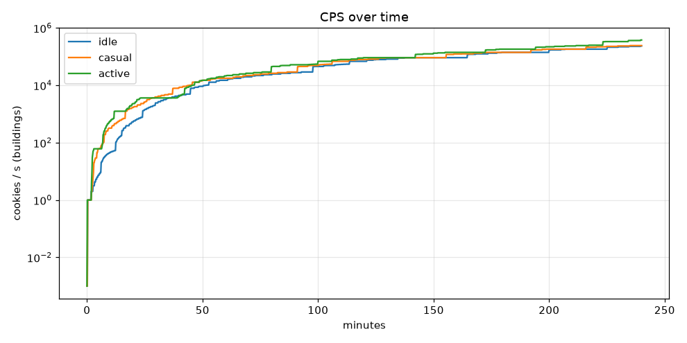
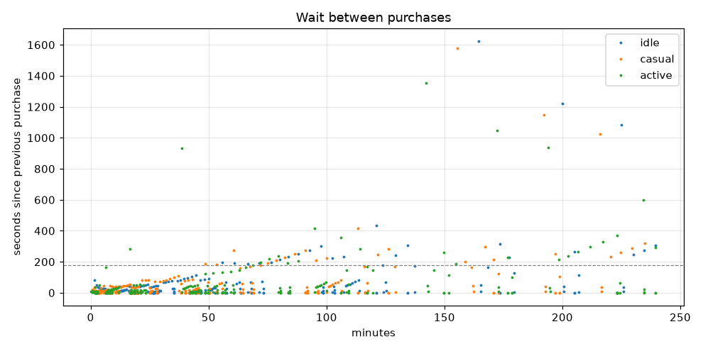
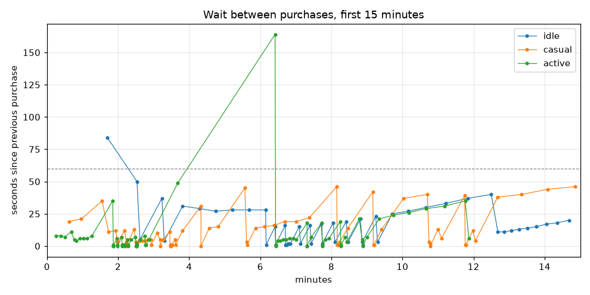

# Balance report 2026-10-25

Configs: `buildings.yml`, `upgrades.yml` · horizon 240 min · targets: 30/30 pass

Click: base power 1, crit 5% × 10 → expected 1.45 × click power

Milestones: ×2 per building at 10, 25, 50, 100, 150, 200 owned

## Targets

| Target | Profile | Result | Limit | |
|---|---|---|---|---|
| first-villager-baker | casual | 18s | ≤ 20s | ✅ |
| first-villager-baker | active | 7s | ≤ 20s | ✅ |
| first-wheat-farm | casual | 2m14s | ≤ 3m00s | ✅ |
| first-wheat-farm | active | 1m52s | ≤ 3m00s | ✅ |
| no-dead-zones-early | casual | 5s | ≤ 1m00s | ✅ |
| no-dead-zones-early | active | 2s | ≤ 1m00s | ✅ |
| first-cow-barn | casual | 4m20s | ≤ 20m00s | ✅ |
| first-cow-barn | active | 2m16s | ≤ 20m00s | ✅ |
| first-cow-barn-idle | idle | 12m41s | ≤ 30m00s | ✅ |
| first-industrial-oven | casual | 21m49s | 20m00s – 1h30m00s | ✅ |
| first-industrial-oven-fast | active | 18m16s | ≤ 1h30m00s | ✅ |
| first-industrial-oven-idle | idle | 30m42s | ≤ 2h00m00s | ✅ |
| first-chicken-farm | casual | 1h53m17s | 1h30m00s – 4h00m00s | ✅ |
| first-chicken-farm-active | active | 1h45m58s | ≤ 4h00m00s | ✅ |
| rebirth-threshold-not-early | casual | 3h38m20s | ≥ 3h30m00s | ✅ |
| rebirth-threshold-not-early-active | active | 3h16m23s | ≥ 3h00m00s | ✅ |
| no-dead-zones | casual | 5s | ≤ 3m00s | ✅ |
| no-dead-zones | active | 2s | ≤ 3m00s | ✅ |
| idle-no-stall | idle | 12s | ≤ 10m00s | ✅ |
| recipe-book | casual | 10m02s | 5m00s – 20m00s | ✅ |
| recipe-book-active | active | 3m41s | ≤ 20m00s | ✅ |
| recipe-book-idle | idle | 17m37s | ≤ 30m00s | ✅ |
| first-recipe-soon | idle | 47s | ≤ 10m00s | ✅ |
| first-recipe-soon | casual | 1m04s | ≤ 10m00s | ✅ |
| first-recipe-soon | active | 4m45s | ≤ 10m00s | ✅ |
| all-recipes | casual | 2h50m52s | 2h00m00s – 4h00m00s | ✅ |
| all-recipes | active | 2h34m56s | 2h00m00s – 4h00m00s | ✅ |
| recipe-ingredient-wait | idle | 9m59s | ≤ 15m00s | ✅ |
| recipe-ingredient-wait | casual | 9m59s | ≤ 15m00s | ✅ |
| recipe-ingredient-wait | active | 9m59s | ≤ 15m00s | ✅ |

## Time to Nth building

| Building | idle #1 | idle #10 | idle #25 | idle #50 | idle #100 | casual #1 | casual #10 | casual #25 | casual #50 | casual #100 | active #1 | active #10 | active #25 | active #50 | active #100 |
|---|---|---|---|---|---|---|---|---|---|---|---|---|---|---|---|
| wheat_farm | 2m37s | 6m51s | 26m37s | never | never | 2m14s | 3m31s | 19m33s | never | never | 1m52s | 2m32s | 18m36s | never | never |
| villager_baker | 18s | 6m09s | 12m30s | never | never | 18s | 2m55s | 17m30s | never | never | 7s | 2m11s | 17m00s | 3h43m16s | never |
| cow_barn | 12m41s | 15m03s | 29m36s | never | never | 4m20s | 7m23s | 25m55s | never | never | 2m16s | 6m56s | 21m40s | never | never |
| sugar_cane_field | 15m48s | 24m10s | 52m43s | never | never | 8m09s | 16m34s | 45m38s | never | never | 7m19s | 11m46s | 46m34s | never | never |
| industrial_oven | 30m42s | 44m47s | 1h53m33s | never | never | 21m49s | 37m09s | 1h46m06s | never | never | 18m16s | 42m13s | 1h39m52s | never | never |
| extra_belt | 55m58s | 1h37m46s | never | never | never | 48m44s | 1h31m09s | never | never | never | 48m37s | 1h19m41s | never | never | never |
| chicken_farm | 2h01m03s | never | never | never | never | 1h53m17s | never | never | never | never | 1h45m58s | 3h43m15s | never | never | never |
| cocoa_plantation | 2h44m31s | never | never | never | never | 2h35m25s | never | never | never | never | 2h22m10s | never | never | never | never |
| shipping_centre | never | never | never | never | never | never | never | never | never | never | never | never | never | never | never |
| alchemy_lab | never | never | never | never | never | never | never | never | never | never | never | never | never | never | never |
| portal_bakery | never | never | never | never | never | never | never | never | never | never | never | never | never | never | never |

## Cookies baked

| Baked | idle | casual | active |
|---|---|---|---|
| 10,000 | 10m12s | 4m20s | 1m53s |
| 750,000 | 28m38s | 20m48s | 15m10s |
| 25,000,000 | 1h09m38s | 1h01m32s | 54m28s |
| 1,000,000,000 | 3h50m06s | 3h38m20s | 3h16m23s |

## Upgrades

| Upgrade | idle | casual | active |
|---|---|---|---|
| bakers_strength | never (level 0 at end) | 58s (level 23 at end) | 23s (level 28 at end) |
| wooden_spatula | never | 37s | 15s |
| stone_rolling_pin | never | 1m33s | 41s |
| iron_rolling_pin | never | 5m34s | 1m51s |
| golden_glove | never | 18m45s | 6m25s |
| diamond_fingers | never | 38m25s | 16m36s |
| netherite_hands | never | 1h00m32s | 38m44s |
| handy_fingers_1 | never | 2h41m27s | 1h34m54s |
| handy_fingers_2 | never | never | never |
| handy_fingers_3 | never | never | never |
| recipe_book | 17m37s | 10m02s | 3m41s |

## Recipes

Time bought, and in brackets the longest wait on ingredients alone (shown, producers running, stock short).

| Recipe | Needs | +CPS | idle | casual | active |
|---|---|---|---|---|---|
| butter | 200 milk + 3,000 cookies | 2% | 18m24s (16s) | 11m06s (16s) | 8m26s (1m39s) |
| oatmeal | 1,500 flour + 10,000 cookies | 2% | 24m18s (3m40s) | 16m42s (4m03s) | 11m52s (5m10s) |
| brown_sugar | 2,000 sugar + 100,000 cookies | 3% | 35m16s (7m35s) | 28m01s (7m31s) | 23m10s (6m38s) |
| caramel | 5,000 sugar, 5,000 milk + 1,000,000 cookies | 3% | 1h01m56s (0s) | 54m28s (0s) | 52m36s (1m31s) |
| macadamia | 2,500 eggs, 20,000 sugar + 10,000,000 cookies | 4% | 2h09m23s (8m19s) | 2h01m37s (8m19s) | 1h54m18s (8m19s) |
| hazelnut | 50,000 flour, 2,000 chocolate + 20,000,000 cookies | 4% | 2h48m17s (3m19s) | 2h38m45s (3m19s) | 2h25m30s (3m19s) |
| chocolate_chips | 4,000 chocolate + 30,000,000 cookies | 5% | 2h57m21s (9m59s) | 2h50m52s (9m59s) | 2h34m56s (9m59s) |

| Ingredient stock at the end | idle | casual | active |
|---|---|---|---|
| flour | 337,730 (+33.6/s) | 351,394 (+33.6/s) | 359,720 (+35.2/s) |
| milk | 902,747 (+80.0/s) | 930,230 (+80.0/s) | 953,222 (+82.0/s) |
| sugar | 724,752 (+72.0/s) | 754,750 (+72.0/s) | 770,098 (+74.0/s) |
| eggs | 99,990 (+35.0/s) | 119,390 (+40.0/s) | 225,235 (+110.0/s) |
| chocolate | 72,280 (+30.0/s) | 87,980 (+30.0/s) | 124,240 (+40.0/s) |

## Per profile

| Profile | Purchases | Longest dead zone (first 15 min) | Longest dead zone | Longest gap between purchases | Final CPS |
|---|---|---|---|---|---|
| idle | 225 | 12s | 12s | 27m05s | 235,777.7 |
| casual | 256 | 5s | 5s | 26m17s | 243,157.7 |
| active | 278 | 2s | 2s | 22m36s | 380,934.0 |

## First 15 minutes (purchases)

| Profile | Purchases (time: id #owned) |
|---|---|
| idle | 18s: villager_baker #1, 1m42s: villager_baker #2, 2m32s: villager_baker #3, 2m37s: wheat_farm #1, 3m14s: villager_baker #4, 3m18s: wheat_farm #2, 3m49s: villager_baker #5, 4m18s: villager_baker #6, 4m45s: villager_baker #7, 5m13s: villager_baker #8, 5m41s: villager_baker #9, 6m09s: villager_baker #10, 6m10s: wheat_farm #3, 6m25s: villager_baker #11, 6m26s: wheat_farm #4, 6m42s: villager_baker #12, 6m43s: wheat_farm #5, 6m44s: wheat_farm #6, 6m45s: wheat_farm #7, 6m47s: wheat_farm #8, 6m49s: wheat_farm #9, 6m51s: wheat_farm #10, 7m06s: villager_baker #13, 7m08s: wheat_farm #11, 7m24s: villager_baker #14, 7m26s: wheat_farm #12, 7m43s: villager_baker #15, 7m45s: wheat_farm #13, 8m03s: villager_baker #16, 8m06s: wheat_farm #14, 8m25s: villager_baker #17, 8m28s: wheat_farm #15, 8m49s: villager_baker #18, 8m52s: wheat_farm #16, 9m15s: villager_baker #19, 9m18s: wheat_farm #17, 9m43s: villager_baker #20, 10m10s: villager_baker #21, 10m40s: villager_baker #22, 11m13s: villager_baker #23, 11m50s: villager_baker #24, 12m30s: villager_baker #25, 12m41s: cow_barn #1, 12m52s: cow_barn #2, 13m04s: cow_barn #3, 13m17s: cow_barn #4, 13m31s: cow_barn #5, 13m46s: cow_barn #6, 14m03s: cow_barn #7, 14m21s: cow_barn #8, 14m41s: cow_barn #9 |
| casual | 18s: villager_baker #1, 37s: wooden_spatula #1, 58s: bakers_strength #1, 1m33s: stone_rolling_pin #1, 1m44s: bakers_strength #2, 1m56s: bakers_strength #3, 1m59s: villager_baker #2, 2m11s: bakers_strength #4, 2m14s: villager_baker #3, 2m14s: wheat_farm #1, 2m27s: bakers_strength #5, 2m30s: villager_baker #4, 2m30s: wheat_farm #2, 2m33s: villager_baker #5, 2m37s: villager_baker #6, 2m41s: villager_baker #7, 2m45s: villager_baker #8, 2m50s: villager_baker #9, 2m55s: villager_baker #10, 2m56s: wheat_farm #3, 3m06s: bakers_strength #6, 3m11s: villager_baker #11, 3m11s: wheat_farm #4, 3m16s: villager_baker #12, 3m27s: bakers_strength #7, 3m28s: wheat_farm #5, 3m28s: wheat_farm #6, 3m29s: wheat_farm #7, 3m29s: wheat_farm #8, 3m30s: wheat_farm #9, 3m31s: wheat_farm #10, 3m36s: villager_baker #13, 3m37s: wheat_farm #11, 3m49s: bakers_strength #8, 4m20s: cow_barn #1, 4m20s: cow_barn #2, 4m34s: cow_barn #3, 4m49s: cow_barn #4, 5m34s: iron_rolling_pin #1, 5m37s: villager_baker #14, 5m38s: wheat_farm #12, 5m52s: cow_barn #5, 6m07s: cow_barn #6, 6m23s: cow_barn #7, 6m42s: cow_barn #8, 7m01s: cow_barn #9, 7m23s: cow_barn #10, 8m09s: sugar_cane_field #1, 8m10s: villager_baker #15, 8m11s: wheat_farm #13, 8m14s: bakers_strength #9, 8m28s: cow_barn #11, 9m10s: sugar_cane_field #2, 9m11s: villager_baker #16, 9m12s: wheat_farm #14, 9m25s: cow_barn #12, 10m02s: recipe_book #1, 10m42s: sugar_cane_field #3, 10m45s: bakers_strength #10, 10m47s: villager_baker #17, 10m47s: wheat_farm #15, 11m00s: cow_barn #13, 11m06s: butter #1, 11m45s: sugar_cane_field #4, 11m46s: villager_baker #18, 11m47s: wheat_farm #16, 11m59s: cow_barn #14, 12m03s: bakers_strength #11, 12m41s: sugar_cane_field #5, 13m21s: sugar_cane_field #6, 14m05s: sugar_cane_field #7, 14m51s: sugar_cane_field #8 |
| active | 7s: villager_baker #1, 15s: wooden_spatula #1, 23s: bakers_strength #1, 30s: bakers_strength #2, 41s: stone_rolling_pin #1, 46s: bakers_strength #3, 50s: bakers_strength #4, 56s: bakers_strength #5, 1m02s: bakers_strength #6, 1m08s: bakers_strength #7, 1m16s: bakers_strength #8, 1m51s: iron_rolling_pin #1, 1m52s: villager_baker #2, 1m52s: wheat_farm #1, 1m52s: villager_baker #3, 1m58s: bakers_strength #9, 1m59s: villager_baker #4, 1m59s: wheat_farm #2, 2m06s: bakers_strength #10, 2m07s: villager_baker #5, 2m07s: villager_baker #6, 2m08s: villager_baker #7, 2m09s: villager_baker #8, 2m10s: villager_baker #9, 2m11s: villager_baker #10, 2m11s: wheat_farm #3, 2m16s: cow_barn #1, 2m17s: villager_baker #11, 2m17s: wheat_farm #4, 2m22s: cow_barn #2, 2m29s: bakers_strength #11, 2m31s: villager_baker #12, 2m31s: wheat_farm #5, 2m31s: wheat_farm #6, 2m31s: wheat_farm #7, 2m31s: wheat_farm #8, 2m31s: wheat_farm #9, 2m32s: wheat_farm #10, 2m37s: cow_barn #3, 2m45s: bakers_strength #12, 2m46s: villager_baker #13, 2m47s: wheat_farm #11, 2m52s: cow_barn #4, 3m41s: recipe_book #1, 6m25s: golden_glove #1, 6m26s: villager_baker #14, 6m26s: wheat_farm #12, 6m30s: cow_barn #5, 6m34s: cow_barn #6, 6m39s: cow_barn #7, 6m44s: cow_barn #8, 6m50s: cow_barn #9, 6m56s: cow_barn #10, 7m01s: bakers_strength #13, 7m19s: sugar_cane_field #1, 7m19s: villager_baker #15, 7m19s: wheat_farm #13, 7m26s: cow_barn #11, 7m44s: sugar_cane_field #2, 7m45s: villager_baker #16, 7m45s: wheat_farm #14, 7m50s: bakers_strength #14, 7m56s: cow_barn #12, 8m15s: sugar_cane_field #3, 8m16s: villager_baker #17, 8m16s: wheat_farm #15, 8m23s: cow_barn #13, 8m26s: butter #1, 8m47s: sugar_cane_field #4, 8m52s: bakers_strength #15, 8m53s: villager_baker #18, 8m53s: wheat_farm #16, 9m00s: cow_barn #14, 9m21s: sugar_cane_field #5, 9m45s: sugar_cane_field #6, 10m11s: sugar_cane_field #7, 10m40s: sugar_cane_field #8, 11m11s: sugar_cane_field #9, 11m46s: sugar_cane_field #10, 11m52s: oatmeal #1 |

## Plots

## Notes (ingredients)

**What changed:** the five ingredient buildings get `produces:` (flour 0.2, milk 0.5, sugar 0.5, eggs 5,
chocolate 10 per second per copy, × milestone factor), only after the one-time `recipe_book` (15K cookies,
shows at 10K baked). Seven recipes (`recipes:` in upgrades.yml) give +2 … +5 % CPS, +23 % in total, as
`total_cps × (1 + Σ)`. `beehive` is now `chicken_farm` with the same numbers. The buyer buys the Recipe Book as
soon as it's affordable and scores recipes by cookie cost per extra cookie/s once their ingredients are in stock.

**Iterations (one lever each):**
1. Recipe costs from the unlock alone (butter 20K … chocolate chips 300M), cocoa unchanged (400M / 40K): 21/30.
   Butter waited 11 min on *cookies* after the book; macadamia/hazelnut/chips came at 3h30+ or never, because
   an optimal player never buys the Cocoa Plantation (payback 10,000 s vs 5,000 s for the Chicken Farm).
2. Recipe Book unlock 5K → 10K, cost 10K → 15K: casual 8m → 10m (inside 5–20 min); active stays ~3m40s, so the
   active target has only a max. Butter 3K / 200 milk: first recipe 1 min after the book.
3. Cookie costs set as `percent × CPS then × ~5,000 s payback` (macadamia 10M, hazelnut 20M, chips 30M) and cocoa
   250M: all 7 recipes at 2h58m casual, but 1B fell to 3h35m (5 min margin).
4. Extra Belt 2M → 2.5M: 1B +7 min (3h43m casual). Chocolate chips 5,000 → 4,000 chocolate: its wait 11m39s → 9m59s.
5. Cocoa 250M / 40K → 150M / 24K (same payback, smaller first copy): the longest gap (saving for the first Cocoa)
   44m → 26m; all recipes at 2h51m casual, 1B 3h38m casual / 3h16m active.

**Known:** the longest gap between purchases is now ~26 min (saving for Cocoa copies at 2h10m–3h35m), up from
~12 min, while other items stay affordable (dead zones ≤ 12 s). Before, nobody bought Cocoa at all.
**Not fixed here:** 1B baked at 3h38m casual vs the GDD's Rebirth at 6–10 h. Closing it needs a longer horizon
and a retune of the Oven/Belt/Chicken/Cocoa tiers together with golden cookies and stars (they speed the run up
further); not a cheap change in this feature.
